<sub>[English](README.md) · [中文](README.zh-CN.md) · **Español** · [日本語](README.ja.md) · [Português](README.pt-BR.md)</sub>

> Traducción informativa de [la versión en inglés](README.md), actualizada el 26/10/2026. Si difieren, prevalece la versión en inglés. Los identificadores, comandos y bloques de código se conservan sin traducir.

<div align="center">

<a id="dcp-ai--digital-citizenship-protocol-for-ai-agents"></a>
<a id="dcp-ai-digital-citizenship-protocol-for-ai-agents"></a>

# DCP-AI — Digital Citizenship Protocol para agentes de IA

<a id="a-portable-accountability-layer-for-ai-agents-on-open-networks"></a>

### Una capa portable de rendición de cuentas para agentes de IA en redes abiertas

[](#protocol-specifications)
[](LICENSE)
[](https://github.com/dcp-ai-protocol/dcp-ai/actions/workflows/ci.yml)
[](https://codecov.io/gh/dcp-ai-protocol/dcp-ai)
[](https://doi.org/10.5281/zenodo.19040913)
[](https://doi.org/10.5281/zenodo.19656026)

[](https://www.npmjs.com/package/@dcp-ai/sdk)
[](https://www.npmjs.com/package/@dcp-ai/cli)
[](https://www.npmjs.com/package/@dcp-ai/wasm)
[](https://pypi.org/project/dcp-ai/)
[](https://crates.io/crates/dcp-ai)
[](https://pkg.go.dev/github.com/dcp-ai-protocol/dcp-ai/sdks/go/v2)
[](https://github.com/dcp-ai-protocol/dcp-ai/pkgs/container/dcp-ai%2Fverification)

</div>

---

<a id="what-is-dcp"></a>

## ¿Qué es DCP?

El **Digital Citizenship Protocol (DCP)** define una capa portable de rendición de cuentas para agentes de IA que permite a cualquier verificador evaluar:

- **Quién es responsable** de un agente (vinculación con el principal responsable),
- **Qué declaró el agente** que pretendía hacer (declaración de intención),
- **Qué resultado de política** se aplicó (decisión de política),
- **Qué evidencia verificable** se produjo (rastro de auditoría),
- **Cómo se gestionan los agentes** a lo largo de su ciclo de vida (gestión del ciclo de vida),
- **Qué ocurre cuando los agentes hacen una transición** o se retiran (sucesión digital),
- **Cómo se resuelven los conflictos** entre agentes y principales (resolución de disputas),
- **Qué derechos y obligaciones** rigen el comportamiento del agente (marco de derechos), y
- **Cómo se delega la autoridad** de las personas a los agentes (representación personal).

DCP combina firmas criptográficas, cadenas de hash y verificación independiente sin exigir un servicio central de verificación. En V2, el RPR, el pasaporte, la intención y la decisión de política se firman individualmente; las entradas de auditoría quedan comprometidas mediante el manifiesto firmado, en lugar de firmarse individualmente.

> Este protocolo lo crearon conjuntamente una persona y un agente de IA: está diseñado para la colaboración que pretende gobernar.

---

<a id="architecture"></a>

## Arquitectura

DCP se organiza en tres capas conceptuales:

### DCP Core

El **protocolo interoperable mínimo** que toda implementación debe admitir. Core define los artefactos, sus relaciones y el modelo de verificación:

- **Responsible Principal Binding** — vincula cada agente con una persona o entidad jurídica que asume la responsabilidad
- **Agent Passport** — la identidad portable del agente, sus capacidades y su material de claves
- **Intent Declaration** — declaración estructurada de lo que el agente pretende hacer, antes de actuar
- **Policy Outcome** — la decisión de autorización aplicada a una intención
- **Action Evidence** — entradas de auditoría encadenadas por hash que permiten detectar manipulaciones, con pruebas de Merkle
- **Bundle Manifest** — el paquete portable que une todos los artefactos para su verificación

Véase [spec/core/](spec/core/) para la especificación del núcleo.

<a id="profiles"></a>

### Perfiles

**Extensiones y especializaciones** que se construyen sobre el núcleo pero no son necesarias para la interoperabilidad básica:

- **Crypto Profile** — selección de algoritmos, firmas híbridas poscuánticas, agilidad criptográfica, política del verificador ([spec/profiles/crypto/](spec/profiles/crypto/))
- **Agent-to-Agent (A2A) Profile** — descubrimiento, handshake, gestión de sesiones, vinculaciones de transporte ([spec/profiles/a2a/](spec/profiles/a2a/))
- **Governance Profile** — niveles de riesgo, atestación de jurisdicción, revocación, recuperación de claves, ceremonias de gobernanza ([spec/profiles/governance/](spec/profiles/governance/))

<a id="services"></a>

### Servicios

**Infraestructura operativa** que da soporte al protocolo pero no forma parte del núcleo normativo:

- Servidores de verificación, servicios de anclaje, registros de transparencia, registros de revocación
- Son decisiones de despliegue, no requisitos del protocolo

---

<a id="protocol-specifications"></a>

## Especificaciones del protocolo

| Especificación | Título | Descripción |
|------|-------|-------------|
| [DCP-01](spec/DCP-01.md) | Identidad y vinculación humana | Identidad del agente, atestación del operador, vinculación de claves |
| [DCP-02](spec/DCP-02.md) | Declaración de intención y control por política | Intenciones declaradas, aplicación de niveles de seguridad, evaluación de políticas |
| [DCP-03](spec/DCP-03.md) | Cadena de auditoría y transparencia | Entradas de auditoría encadenadas por hash, pruebas de Merkle, registros de transparencia |
| [DCP-04](spec/DCP-04.md) | Comunicación entre agentes | Mensajería autenticada entre agentes, delegación, cadenas de confianza |
| [DCP-05](spec/DCP-05.md) | Gestión del ciclo de vida del agente | Poner en servicio, supervisar, declinar y retirar agentes con una máquina de estados |
| [DCP-06](spec/DCP-06.md) | Sucesión digital y herencia | Testamentos digitales, transferencia de memoria, designación de sucesor |
| [DCP-07](spec/DCP-07.md) | Resolución de conflictos y arbitraje de disputas | Disputas, niveles de escalado, arbitraje, jurisprudencia |
| [DCP-08](spec/DCP-08.md) | Marco de derechos y obligaciones | Declaraciones de derechos, registros de obligaciones, notificación de vulneraciones |
| [DCP-09](spec/DCP-09.md) | Representación personal y delegación | Mandatos de delegación, cadenas verificables de subdelegación hasta la persona, umbrales de atención, espejos del principal |
| [DCP-AI v2.0](spec/DCP-AI-v2.0.md) | Especificación normativa poscuántica | Especificación v2.0 completa con criptografía PQ híbrida y modelo de seguridad de 4 niveles |

Véase también: [Especificación del núcleo](spec/core/dcp-core.md) | [Resumen de los perfiles](spec/profiles/)

---

<a id="quick-start"></a>

## Inicio rápido

> **Paquetes publicados (26/10/2026).** npm ya ofrece `@dcp-ai/sdk` 2.2.0, `@dcp-ai/wasm` y `@dcp-ai/cli` 2.1.0, además de los adaptadores y generadores actualizados. Consulta el [inventario de 13 paquetes](docs/NPM_RELEASES.md) y las [notas de actualización de seguridad](SECURITY.md#supported-versions). Estas versiones npm incluyen las correcciones y funciones documentadas; las publicaciones de Python, Go y Rust son independientes. Para ejecutar el CLI de referencia y las pruebas del repositorio, compila el checkout:
>
> ```bash
> git clone https://github.com/dcp-ai-protocol/dcp-ai.git
> cd dcp-ai/sdks/typescript && npm install && npm run build
> cd ../.. && npm install
> ```

<a id="option-a-cli-wizard-demo"></a>

### Opción A: asistente de la CLI (demo)

```bash
npx @dcp-ai/cli init   # the published @dcp-ai/cli
```

El asistente interactivo (`@dcp-ai/cli`) pide un nombre, una jurisdicción, un framework y un nivel de seguridad, y escribe
una carpeta `.dcp/` con claves y registros con forma de RPR y de pasaporte. Es una demo, no una forma de crear una identidad V2:
sus claves «ML-DSA-65» están simuladas (bytes aleatorios), y los registros no están firmados ni cumplen los esquemas V2.
Para crear una identidad y bundles que verifiquen, sigue el inicio rápido de tu SDK (opción B). Los límites se enumeran
en
[Creación de agentes](docs/AGENT_CREATION_AND_CERTIFICATION.md#cli-wizard-demo-only).

El asistente de este repositorio necesita `@dcp-ai/sdk` 2.2.0; desde una copia del repositorio (tras compilar el SDK como arriba), ejecútalo
en el directorio de tu proyecto:

```bash
cd /path/to/dcp-ai/cli
npm install --no-save --package-lock=false --ignore-scripts --install-links ../sdks/typescript
cd /path/to/your-project && node /path/to/dcp-ai/cli/bin/dcp-ai.js init
```

La CLI de referencia de más bajo nivel, `bin/dcp.js` en la raíz de la copia, sirve para scripts y pipelines de CI. Solo
lee y escribe dentro del directorio actual:

```bash
cd /path/to/your-bundles
node /path/to/dcp-ai/bin/dcp.js verify-bundle --policy hybrid_preferred bundle.signed.json
```

<a id="option-b-sdk-directly"></a>

### Opción B: el SDK directamente

Instala una de las dos:

- el SDK de `main`, compilado desde un checkout, para desarrollar el código fuente:

  ```bash
  npm install /path/to/dcp-ai/sdks/typescript
  ```

- o el SDK 2.2.0 publicado, que incluye estas correcciones y funciones:

  ```bash
  npm install @dcp-ai/sdk@^2.2.0
  ```

Verifica un bundle V2 firmado con el verificador de bundles V2 actual de `main` (firmas, hashes, vinculación de sesión,
nivel de seguridad). Comprueba la cadena de auditoría primaria, no la cadena secundaria SHA3-256 opcional (véase
[Cadenas de doble hash](docs/STORAGE_AND_ANCHORING.md#dual-hash-chains)):

```typescript
import { readFileSync } from 'node:fs';
import { getDefaultRegistry, registerDefaultProviders, verifySignedBundleV2 } from '@dcp-ai/sdk';

registerDefaultProviders();
const signedBundle = JSON.parse(readFileSync('bundle.signed.json', 'utf8'));
const result = await verifySignedBundleV2(signedBundle, getDefaultRegistry());
console.log(result.verified, result.errors);
```

Un bundle verificado prueba su integridad y la firma con las claves que enumera, no quién es el principal: para aceptar
evidencias solo de principales en los que confías, usa la [admisión](docs/ADMISSION.md). Ni la verificación ni la admisión
autorizan una acción. Para construir y firmar bundles, sigue
el inicio rápido de tu SDK: [TypeScript](sdks/typescript/README.md#quick-start-v2),
[Python](sdks/python/README.md#quickstart), [Go](sdks/go/README.md#quickstart--v2),
[Rust](sdks/rust/README.md#quickstart) o [WASM](sdks/wasm/README.md#quickstart--typescript-wrapper).

---

<a id="security-tiers"></a>

## Niveles de seguridad

| Nivel | Modo de verificación | Checkpoint PQ | Uso típico |
|------|-------------------|---------------|-------------|
| **Routine** | `classical_only` | cada 50 eventos | Lectura de datos públicos, consultas informativas |
| **Standard** | `hybrid_preferred` | cada 10 eventos | Acceso a API, operaciones estándar del agente |
| **Elevated** | `hybrid_required` | cada evento | Transacciones financieras, acceso a datos personales, delegación entre organizaciones |
| **Maximum** | `hybrid_required` | cada evento | Sistemas gubernamentales, infraestructuras críticas, sectores regulados |

El nivel se calcula para cada acción a partir de la intención y de la puntuación de riesgo de la política (spec §14.2), y un verificador
aplica el más estricto entre su propio modo y el del nivel (spec §14.3). La atestación del operador o multiparte,
las claves ligadas a hardware y el anclaje son decisiones de despliegue: los SDK no los exigen ni los comprueban en ningún nivel.

---

<a id="ecosystem"></a>

## Ecosistema

```mermaid
graph TB
  subgraph sdks["SDKs (5 languages)"]
    TS["TypeScript SDK"]
    PY["Python SDK"]
    GO["Go SDK"]
    RS["Rust SDK"]
    WA["WASM Module"]
  end

  subgraph integrations["Integrations (11)"]
    EX["Express Middleware"]
    FA["FastAPI Middleware"]
    LC["LangChain"]
    OA["OpenAI"]
    CR["CrewAI"]
    AGNO["Agno (agno-dcp)"]
    OC["OpenClaw Plugin"]
    W3C["W3C DID/VC Bridge"]
    A2A["Google A2A Bridge"]
    MCP["Anthropic MCP Bridge"]
    AG["AutoGen Bridge"]
  end

  subgraph tools["Tooling"]
    CLI["CLI Wizard"]
    PG["Playground"]
    TPL["Templates"]
  end

  subgraph services["Infrastructure Services"]
    VER["Verification Server"]
    ANC["Anchoring Service"]
    TL["Transparency Log"]
    REV["Revocation Service"]
  end

  subgraph infra["Deployment"]
    SOL["Smart Contract L2"]
    GH["GitHub Actions"]
    DK["Docker Compose"]
  end

  TS --> EX
  TS --> OC
  TS --> W3C
  TS --> A2A
  TS --> MCP
  TS --> AG
  PY --> FA
  PY --> LC
  PY --> OA
  PY --> CR
  RS --> WA

  CLI --> TS
  TPL --> LC
  TPL --> CR
  TPL --> OA
  TPL --> EX

  VER -. "strict-v1 configured source" .-> REV
  ANC -. "planned on-chain submission" .-> SOL
  DK --> VER
  DK --> ANC
  DK --> TL
  DK --> REV
  GH --> VER
```



---

<a id="sdks"></a>

## SDK

Crea, firma y verifica Citizenship Bundles en el lenguaje que prefieras. Todos los SDK admiten DCP v2.0 y criptografía híbrida poscuántica.

| SDK | Paquete | Funciones | Documentación |
|-----|---------|----------|------|
| **TypeScript** | `@dcp-ai/sdk` | BundleBuilder, criptografía PQ híbrida, validación con JSON Schema, Vitest | [sdks/typescript/](sdks/typescript/README.md) |
| **Python** | `dcp-ai` | Modelos de Pydantic v2, CLI (Typer), extras PQ, complementos opcionales | [sdks/python/](sdks/python/README.md) |
| **Go** | `github.com/dcp-ai-protocol/dcp-ai/sdks/go/v2` | Tipos nativos, firmas híbridas, verificación de bundles | [sdks/go/](sdks/go/README.md) |
| **Rust** | `dcp-ai` | serde, ed25519-dalek + fips203/204/205, función WASM opcional | [sdks/rust/](sdks/rust/README.md) |
| **WASM** | `@dcp-ai/wasm` | Verificación en el navegador, criptografía PQ en WebAssembly, compilado desde Rust | [sdks/wasm/](sdks/wasm/README.md) |

---

<a id="framework-integrations"></a>

## Integraciones con frameworks

Gobernanza DCP lista para usar con frameworks web y de IA populares.

| Integración | Paquete | Patrón | Documentación |
|-------------|---------|---------|------|
| **Express** | [](https://www.npmjs.com/package/@dcp-ai/express) | Middleware `dcpVerify()`, `req.dcpAgent` | [integrations/express/](integrations/express/README.md) |
| **FastAPI** | [](https://pypi.org/project/dcp-ai/) | `DCPVerifyMiddleware`, `Depends(require_dcp)` | [integrations/fastapi/](integrations/fastapi/README.md) |
| **LangChain** | [](https://pypi.org/project/dcp-ai/) | `DCPAgentWrapper`, `DCPTool`, `DCPCallback` | [integrations/langchain/](integrations/langchain/README.md) |
| **OpenAI** | [](https://pypi.org/project/dcp-ai/) | `DCPOpenAIClient`, llamadas a funciones con `DCP_TOOLS` | [integrations/openai/](integrations/openai/README.md) |
| **CrewAI** | [](https://pypi.org/project/dcp-ai/) | `DCPCrewAgent`, `DCPCrew`, gobernanza multiagente | [integrations/crewai/](integrations/crewai/README.md) |
| **Agno** | [](https://pypi.org/project/agno-dcp/) | Envoltorios `DCPAgent`, `DCPTeam`, `DCPWorkflow` (paquete independiente) | [repositorio de agno-dcp](https://github.com/dcp-ai-protocol/agno-dcp) |
| **OpenClaw** | [](https://www.npmjs.com/package/@dcp-ai/openclaw) | Complemento + SKILL.md, 6 herramientas para agentes | [integrations/openclaw/](integrations/openclaw/README.md) |
| **W3C DID/VC** | [](https://www.npmjs.com/package/@dcp-ai/w3c-did) | Puente entre documento DID e identidad DCP, emisión de VC | [integrations/w3c-did/](integrations/w3c-did/README.md) |
| **Google A2A** | [](https://www.npmjs.com/package/@dcp-ai/google-a2a) | Pasaporte DCP firmado dentro de la Agent Card de A2A (`verifyAgentCardPassport`), tareas a intenciones | [integrations/google-a2a/](integrations/google-a2a/README.md) |
| **Anthropic MCP** | [](https://www.npmjs.com/package/@dcp-ai/anthropic-mcp) | Recibo DCP firmado por cada llamada a una herramienta MCP (`withDcpReceipt`), herramientas y recursos DCP | [integrations/anthropic-mcp/](integrations/anthropic-mcp/README.md) |
| **AutoGen** | [](https://www.npmjs.com/package/@dcp-ai/autogen) | Envoltorio entre agente de AutoGen y DCP, gobernanza de chats de grupo | [integrations/autogen/](integrations/autogen/README.md) |

---

<a id="templates"></a>

## Plantillas

Recorridos de inicio para frameworks habituales. Muestran dónde encajan la identidad, la intención, la política, el registro de auditoría y el
sellado del bundle, con claves y firmas de relleno (`«generated»`, `«sig»`): no generan claves, no firman nada
y sus bundles no verifican. El middleware de la plantilla de Express comprueba solo la estructura del bundle, no las firmas ni la
admisión. Para claves, firmas y verificación reales, usa los [inicios rápidos](docs/README.md) y las
[integraciones con frameworks](#framework-integrations).

| Plantilla | Descripción | Comando |
|----------|-------------|---------|
| **LangChain** | Llamada de LangChain.js envuelta en el flujo DCP, con firmas de relleno | `npm create @dcp-ai/langchain my-app` |
| **CrewAI** | Simulación de un equipo multiagente con pasaportes DCP y rastro de auditoría, con firmas de relleno | `npm create @dcp-ai/crewai my-app` |
| **OpenAI** | Llamadas a funciones de OpenAI envueltas con intención, política y auditoría DCP, con firmas de relleno | `npm create @dcp-ai/openai my-app` |
| **Express** | Servidor Express con una comprobación DCP estructural (sin verificación de firmas) y endpoints de descubrimiento | `npm create @dcp-ai/express my-app` |

`npm create @dcp-ai/<name>` ejecuta el generador `@dcp-ai/create-<name>`, que copia la plantilla en una carpeta
nueva. Véase [templates/](templates/) para el código completo.

---

## Playground

Un playground web interactivo para explorar los conceptos de DCP: crea identidades, declara intenciones, firma bundles y verifica firmas directamente en el navegador. Su criptografía se ejecuta localmente con `tweetnacl` y Web Crypto. Es una demostración: sus firmas
poscuánticas están simuladas y su forma canónica y su raíz de Merkle están simplificadas, así que lo que construye no es evidencia
y no tiene por qué verificar con los verificadores de los SDK (véanse sus [limitaciones](playground/README.md#limitations)).

```bash
# From the repository root; ES modules require HTTP, not file://
python3 -m http.server 8080 --bind 127.0.0.1 --directory playground
# Open http://localhost:8080 in your browser
```

Véase [playground/](playground/) para más detalles.

---

<a id="infrastructure-services"></a>

## Servicios de infraestructura

Servicios de backend para anclaje, transparencia y revocación. Son componentes operativos, no parte del protocolo normativo del núcleo.

| Servicio | Puerto | Descripción | Documentación |
|---------|------|-------------|------|
| **Verification** | 3000 | API HTTP para verificar Signed Bundles | [server/](server/README.md) |
| **Anchoring** | 3001 | Agrupación en lotes de Merkle de los hashes de bundles, registrados localmente; el envío on-chain no está implementado | [services/anchor/](services/anchor/README.md) |
| **Transparency Log** | 3002 | Registro de Merkle al estilo CT con pruebas de inclusión | [services/transparency-log/](services/transparency-log/README.md) |
| **Revocation** | 3003 | Registro de revocación de agentes + `.well-known` | [services/revocation/](services/revocation/README.md) |

Despliega todos los servicios con un solo comando:

```bash
cd docker && docker compose up -d
```

---

<a id="documentation"></a>

## Documentación

<a id="normative-specifications"></a>

### Especificaciones normativas

| Documento | Descripción |
|----------|-------------|
| [DCP-01](spec/DCP-01.md) | Identidad y vinculación humana |
| [DCP-02](spec/DCP-02.md) | Declaración de intención y control por política |
| [DCP-03](spec/DCP-03.md) | Cadena de auditoría y transparencia |
| [DCP-04](spec/DCP-04.md) | Comunicación entre agentes |
| [DCP-05](spec/DCP-05.md) | Gestión del ciclo de vida del agente |
| [DCP-06](spec/DCP-06.md) | Sucesión digital y herencia |
| [DCP-07](spec/DCP-07.md) | Resolución de conflictos y arbitraje de disputas |
| [DCP-08](spec/DCP-08.md) | Marco de derechos y obligaciones |
| [DCP-09](spec/DCP-09.md) | Representación personal y delegación |
| [DCP-AI v2.0](spec/DCP-AI-v2.0.md) | Especificación normativa poscuántica |
| [BUNDLE](spec/BUNDLE.md) | Formato del Citizenship Bundle |
| [VERIFICATION](spec/VERIFICATION.md) | Procedimientos y lista de comprobación de la verificación |
| [CANONICALIZATION_PROFILE](spec/CANONICALIZATION_PROFILE.md) | Perfil de JSON canónico `dcp-jcs-v1` en el que se basan todas las firmas y hashes |
| [DCP Core](spec/core/dcp-core.md) | Especificación editorial del protocolo del núcleo |
| [Profiles](spec/profiles/README.md) | Perfiles opcionales: criptografía, A2A, gobernanza y admisión (`strict-v1`) |

<a id="getting-started"></a>

### Primeros pasos

| Guía | Descripción |
|-------|-------------|
| [QUICKSTART](docs/QUICKSTART.md) | Guía general de inicio rápido |
| [QUICKSTART_LANGCHAIN](docs/QUICKSTART_LANGCHAIN.md) | Recorrido por la integración con LangChain |
| [QUICKSTART_CREWAI](docs/QUICKSTART_CREWAI.md) | Configuración multiagente con CrewAI |
| [QUICKSTART_AGNO](docs/QUICKSTART_AGNO.md) | Agentes, equipos y flujos de trabajo de Agno con `agno-dcp` (demo en vivo) |
| [QUICKSTART_OPENAI](docs/QUICKSTART_OPENAI.md) | Integración con las llamadas a funciones de OpenAI |
| [QUICKSTART_EXPRESS](docs/QUICKSTART_EXPRESS.md) | Configuración del middleware de Express |

<a id="api-reference"></a>

### Referencia de la API

| Documento | Descripción |
|----------|-------------|
| [OpenAPI Spec](api/openapi.yaml) | API REST (OpenAPI 3.1) |
| [Protocol Buffers](api/proto/) | Definiciones de servicios gRPC |
| [API README](api/README.md) | Resumen y uso de la API |

<a id="architecture--security"></a>
<a id="architecture-security"></a>

### Arquitectura y seguridad

| Documento | Descripción |
|----------|-------------|
| [TECHNICAL_ARCHITECTURE](docs/TECHNICAL_ARCHITECTURE.md) | Arquitectura del sistema para despliegues a escala global |
| [SECURITY_MODEL](docs/SECURITY_MODEL.md) | Modelo de amenazas, vectores de ataque, capas de protección |
| [STORAGE_AND_ANCHORING](docs/STORAGE_AND_ANCHORING.md) | Almacenamiento P2P, anclaje opcional en blockchain |
| [ARCHITECTURE](docs/ARCHITECTURE.md) | Mapa del repositorio para colaboradores |

<a id="testing--assurance"></a>
<a id="testing-assurance"></a>

### Pruebas y garantías

| Herramienta | Descripción |
|------|-------------|
| [Interop matrix](tools/interop-matrix/README.md) | Agentes en vivo sobre los cuatro SDK (y el verificador de referencia) crean, firman y verifican los citizenship bundles de los demás, intactos y manipulados en tránsito |
| [Differential fuzzer](tools/difffuzz/README.md) | El mismo bundle firmado y mutado pasa por los verificadores de los cuatro SDK; cualquier discrepancia es un hallazgo |
| [Shared vectors](tests/interop/v2/) | Bundles, cadenas de mandatos y casos de ataque que todos los SDK deben aceptar o rechazar de la misma manera |

<a id="guides"></a>

### Guías

| Guía | Descripción |
|-------|-------------|
| [AGENT_CREATION_AND_CERTIFICATION](docs/AGENT_CREATION_AND_CERTIFICATION.md) | Flujo de creación de agentes P2P, certificación DCP |
| [OPERATOR_GUIDE](docs/OPERATOR_GUIDE.md) | Ejecutar un servicio de verificación |
| [MIGRATION_V1_V2](docs/MIGRATION_V1_V2.md) | Migrar de DCP v1.0 a v2.0 |
| [ADMISSION](docs/ADMISSION.md) | Aceptar bundles solo de principales de confianza, opcionalmente bajo `strict-v1` |
| [OBSERVABILITY](docs/OBSERVABILITY.md) | Trazas y métricas de OpenTelemetry desde los SDK |

<a id="proposals-experimental-not-normative"></a>

### Propuestas (experimentales, no normativas)

| Documento | Descripción |
|----------|-------------|
| [Candidato de canonicalización `dcp-jcs-v2`](docs/proposals/canonicalization-candidate/README.md) | Perfil candidato experimental, desactivado por defecto, su diseño y las API opt-in de los SDK; `dcp-jcs-v1` sigue siendo el perfil de canonicalización predeterminado y el único normativo |

<a id="standards-alignment"></a>

### Alineación con estándares

| Documento | Descripción |
|----------|-------------|
| [NIST_CONFORMITY](docs/NIST_CONFORMITY.md) | Conformidad con la criptografía poscuántica del NIST |
| [EU_AI_ACT_MAPPING](docs/EU_AI_ACT_MAPPING.md) | Obligaciones de registro, supervisión humana y conservación de registros del Reglamento de IA de la UE asignadas a artefactos DCP |
| [ROADMAP](ROADMAP.md) | Hoja de ruta de la evolución del proyecto |

<a id="community"></a>

### Comunidad

| Documento | Descripción |
|----------|-------------|
| [EARLY_ADOPTERS](docs/EARLY_ADOPTERS.md) | Programa de primeros usuarios y casos de estudio |
| [CONTRIBUTING](CONTRIBUTING.md) | Pautas de contribución |
| [GOVERNANCE](GOVERNANCE.md) | Modelo de gobernanza del proyecto |

### Visión

| Documento | Descripción |
|----------|-------------|
| [GENESIS_PAPER](docs/GENESIS_PAPER.md) | Documento técnico fundacional |

---

<a id="cryptographic-algorithms"></a>

## Algoritmos criptográficos

DCP v2.0 emplea una arquitectura criptográfica híbrida para una seguridad resistente a la computación cuántica. La selección de algoritmos y la agilidad criptográfica se rigen por el [Crypto Profile](spec/profiles/crypto/).

Esta tabla describe el diseño del protocolo. Los SDK no ejecutan el intercambio combinado X25519 + ML-KEM-768; el llamador proporciona la clave de sesión A2A. Los verificadores actuales de bundles V2 no recalculan la cadena de auditoría secundaria opcional ni la raíz de Merkle secundaria. Consulta la [conformidad NIST](docs/NIST_CONFORMITY.md) y el [modelo de seguridad](docs/SECURITY_MODEL.md) para conocer los límites de implementación.

| Algoritmo | Estándar | Propósito |
|-----------|----------|---------|
| **Ed25519** | RFC 8032 | Firmas digitales clásicas |
| **ML-DSA-65** | FIPS 204 | Firmas digitales poscuánticas (Dilithium) |
| **ML-KEM-768** | FIPS 203 | Mecanismo de encapsulación de claves poscuántico (Kyber) |
| **SLH-DSA-192f** | FIPS 205 | Firmas de respaldo basadas en hash (SPHINCS+) |
| **X25519 + ML-KEM-768** | Híbrido | Intercambio de claves combinado clásico + PQ |
| **SHA-256 + SHA3-256** | FIPS 180-4 / FIPS 202 | Cadenas de doble hash para la integridad de la auditoría |

---

<a id="repository-layout"></a>

## Estructura del repositorio

```
dcp-ai/
├── spec/                    # Normative specifications (DCP-01 through DCP-09, v2.0)
│   ├── core/                # DCP Core editorial specification
│   └── profiles/            # Profile specifications (crypto, a2a, governance, admission)
├── schemas/                 # JSON Schemas (draft 2020-12, v2 includes DCP-05–09)
├── tools/                   # Validation, conformance, crypto + Merkle helpers
│   ├── interop-matrix/      # Live interoperability between agents on the four SDKs
│   ├── difffuzz/            # Differential fuzzer of the four V2 verifiers
│   └── canonicalization-lab/ # Design model of the dcp-jcs-v2 candidate
├── tests/                   # Conformance tests, fixtures, interop vectors (tests/interop/candidate: experimental)
├── bin/dcp.js               # Reference CLI
├── cli/                     # Interactive CLI wizard (@dcp-ai/cli)
├── sdks/
│   ├── typescript/          # TypeScript SDK (@dcp-ai/sdk)
│   ├── python/              # Python SDK (dcp-ai)
│   ├── go/                  # Go SDK
│   ├── rust/                # Rust SDK (dcp-ai)
│   └── wasm/                # WASM module (@dcp-ai/wasm)
├── integrations/
│   ├── express/             # Express middleware
│   ├── fastapi/             # FastAPI middleware
│   ├── langchain/           # LangChain integration
│   ├── openai/              # OpenAI integration
│   ├── crewai/              # CrewAI integration
│   ├── openclaw/            # OpenClaw plugin
│   ├── w3c-did/             # W3C DID/VC bridge
│   ├── google-a2a/          # Google A2A bridge
│   ├── anthropic-mcp/       # Anthropic MCP bridge
│   └── autogen/             # Microsoft AutoGen bridge
├── templates/               # Framework templates (langchain, crewai, openai, express)
├── packages/create-*/       # npm create @dcp-ai/<name> scaffolders
├── playground/              # Web-based interactive playground
├── server/                  # Reference verification server
├── services/
│   ├── anchor/              # Blockchain anchoring service
│   ├── transparency-log/    # CT-style Merkle transparency log
│   └── revocation/          # Agent revocation registry
├── contracts/ethereum/      # DCPAnchor.sol for EVM L2
├── docker/                  # Docker Compose + multi-stage Dockerfile
├── api/                     # OpenAPI 3.1 + Protocol Buffers (gRPC)
├── docs/                    # Guides, architecture, standards alignment; docs/proposals: experimental designs
└── .github/                 # CI/CD workflows + reusable GitHub Actions
```

---

<a id="development"></a>

## Desarrollo

```bash
# Build the workspace SDK first: the root uses it to test the checked-out source
(cd sdks/typescript && npm install && npm run build)

# Install dependencies
npm install

# Run tests
npm test

# Run protocol conformance suite
npm run conformance

# Cross-SDK checks (build sdks/typescript first; needs Python, Go and Rust)
node tools/interop-matrix/run.mjs
node tools/difffuzz/run.mjs

# Start verification server (port 3000)
npm run server
```

---

<a id="contributing"></a>

## Contribuir

Damos la bienvenida a contribuciones tanto de personas como de agentes de IA.

- Lee la [Guía de contribución](CONTRIBUTING.md) para conocer el flujo de trabajo y los estándares de desarrollo.
- Consulta [Gobernanza](GOVERNANCE.md) para los procesos de decisión y los roles.

---

<a id="citation"></a>

## Cita

Si usas DCP-AI en tu investigación, cita tanto el artículo (el marco conceptual) como la versión del software (la implementación concreta que usaste).

**Artículo**

> Naranjo Emparanza, D. (2026). *Agents Don't Need a Better Brain — They Need a World: Toward a Digital Citizenship Protocol for Autonomous AI Systems*. Zenodo. https://doi.org/10.5281/zenodo.19040913

**Software**

Cita la versión que usaste. El DOI de concepto [`10.5281/zenodo.19656025`](https://doi.org/10.5281/zenodo.19656025)
resuelve a la última versión archivada; la versión v2.0.2 tiene el suyo propio:

> Naranjo Emparanza, D. (2026). *DCP-AI v2.0.2 — Digital Citizenship Protocol for AI Agents (Reference Implementation)*. Zenodo. https://doi.org/10.5281/zenodo.19656026

Véase [`CITATION.cff`](CITATION.cff) para un formato legible por máquinas.

---

<a id="license"></a>

## Licencia

[Apache-2.0](LICENSE)

---

<div align="center">

*«Este protocolo lo crearon conjuntamente una persona y un agente de IA: el primer protocolo diseñado para la ciudadanía digital de la IA, construido por la misma colaboración que pretende gobernar.»*

</div>
