<sub>[English](README.md) · [中文](README.zh-CN.md) · [Español](README.es.md) · **日本語** · [Português](README.pt-BR.md)</sub>

> [英語版](README.md)の参考訳です（26/10/2026 更新）。内容が異なる場合は英語版が優先されます。識別子、コマンド、コードブロックは翻訳せずにそのまま掲載しています。

<div align="center">

<a id="dcp-ai--digital-citizenship-protocol-for-ai-agents"></a>
<a id="dcp-ai-digital-citizenship-protocol-for-ai-agents"></a>

# DCP-AI — AI エージェントのための Digital Citizenship Protocol

<a id="a-portable-accountability-layer-for-ai-agents-on-open-networks"></a>

### オープンなネットワーク上の AI エージェントのための、持ち運び可能な説明責任のレイヤー

[](#protocol-specifications)
[](LICENSE)
[](https://github.com/dcp-ai-protocol/dcp-ai/actions/workflows/ci.yml)
[](https://codecov.io/gh/dcp-ai-protocol/dcp-ai)
[](https://doi.org/10.5281/zenodo.19040913)
[](https://doi.org/10.5281/zenodo.19656026)

[](https://www.npmjs.com/package/@dcp-ai/sdk)
[](https://www.npmjs.com/package/@dcp-ai/cli)
[](https://www.npmjs.com/package/@dcp-ai/wasm)
[](https://pypi.org/project/dcp-ai/)
[](https://crates.io/crates/dcp-ai)
[](https://pkg.go.dev/github.com/dcp-ai-protocol/dcp-ai/sdks/go/v2)
[](https://github.com/dcp-ai-protocol/dcp-ai/pkgs/container/dcp-ai%2Fverification)

</div>

---

<a id="what-is-dcp"></a>

## DCP とは

**Digital Citizenship Protocol（DCP）**は、AI エージェントのための持ち運び可能な説明責任のレイヤーを定め、どの検証者でも次のことを評価できるようにします。

- エージェントについて**誰が責任を負うのか**（責任あるプリンシパルとの結び付け）
- エージェントが何をするつもりだと**宣言したのか**（意図の宣言）
- **どのようなポリシーの結果**が適用されたのか（ポリシー判断）
- **どのような検証可能な証拠**が生成されたのか（監査証跡）
- エージェントがライフサイクル全体を通じて**どのように管理されるのか**（ライフサイクル管理）
- エージェントが**移行する**、または稼働を終了するときに何が起きるのか（デジタル継承）
- エージェントとプリンシパルの間の**紛争がどのように解決されるのか**（紛争解決）
- **どのような権利と義務**がエージェントの振る舞いを律するのか（権利の枠組み）
- **権限が人間からエージェントへどのように委任されるのか**（個人の代理）

DCP は、中央の検証サービスを必要とせず、暗号署名、ハッシュチェーン、独立した検証を組み合わせます。V2 では、RPR、パスポート、意図、ポリシー判断がそれぞれ個別に署名されます。監査エントリは個別に署名されるのではなく、署名済みマニフェストのコミットメントによって結び付けられます。

> このプロトコルは、人間と AI エージェントが共同で作りました。統治しようとする協働そのもののために設計されています。

---

<a id="architecture"></a>

## アーキテクチャ

DCP は 3 つの概念的なレイヤーで構成されています。

### DCP Core

すべての実装が対応しなければならない**最小限の相互運用可能なプロトコル**です。Core はアーティファクト、その関係、検証モデルを定義します。

- **Responsible Principal Binding** — 各エージェントを、説明責任を引き受ける人間または法人に結び付ける
- **Agent Passport** — エージェントの持ち運び可能なアイデンティティ、機能、鍵の素材
- **Intent Declaration** — エージェントが行動する前に、何をするつもりかを構造化して宣言する
- **Policy Outcome** — 意図に適用された承認の判断
- **Action Evidence** — ハッシュで連鎖し、改ざんを検出できる、マークル証明付きの監査エントリ
- **Bundle Manifest** — 検証のためにすべてのアーティファクトを束ねる持ち運び可能なパッケージ

コアの仕様は [spec/core/](spec/core/) を参照してください。

<a id="profiles"></a>

### プロファイル

コアの上に構築されるものの、基本的な相互運用には必要ない**拡張と特化**です。

- **Crypto Profile** — アルゴリズムの選択、ポスト量子のハイブリッド署名、暗号の俊敏性、検証器のポリシー（[spec/profiles/crypto/](spec/profiles/crypto/)）
- **Agent-to-Agent (A2A) Profile** — ディスカバリー、ハンドシェイク、セッション管理、トランスポートのバインディング（[spec/profiles/a2a/](spec/profiles/a2a/)）
- **Governance Profile** — リスクティア、管轄の証明、失効、鍵の回復、ガバナンスのセレモニー（[spec/profiles/governance/](spec/profiles/governance/)）

<a id="services"></a>

### サービス

プロトコルを支えるものの、規範的なコアには含まれない**運用インフラ**です。

- 検証サーバー、アンカリングサービス、透明性ログ、失効レジストリ
- これらはデプロイ上の選択であり、プロトコルの要件ではありません

---

<a id="protocol-specifications"></a>

## プロトコル仕様

| 仕様 | タイトル | 説明 |
|------|-------|-------------|
| [DCP-01](spec/DCP-01.md) | アイデンティティと人間との結び付け | エージェントのアイデンティティ、オペレーターによる証明、鍵の結び付け |
| [DCP-02](spec/DCP-02.md) | 意図の宣言とポリシーによる制御 | 宣言された意図、セキュリティティアの適用、ポリシーの評価 |
| [DCP-03](spec/DCP-03.md) | 監査チェーンと透明性 | ハッシュで連鎖した監査エントリ、マークル証明、透明性ログ |
| [DCP-04](spec/DCP-04.md) | エージェント間通信 | 認証されたエージェント間メッセージ、委任、信頼の連鎖 |
| [DCP-05](spec/DCP-05.md) | エージェントのライフサイクル管理 | 状態機械による、エージェントの稼働開始、監視、衰退、稼働終了 |
| [DCP-06](spec/DCP-06.md) | デジタル継承と相続 | デジタル遺言、メモリーの移転、後継者の指定 |
| [DCP-07](spec/DCP-07.md) | 紛争の解決と仲裁 | 紛争、エスカレーションレベル、仲裁、判例 |
| [DCP-08](spec/DCP-08.md) | 権利と義務の枠組み | 権利の宣言、義務の記録、違反の報告 |
| [DCP-09](spec/DCP-09.md) | 個人の代理と委任 | 委任状、人間までさかのぼれる検証可能なサブ委任のチェーン、注意の閾値、プリンシパルのミラー |
| [DCP-AI v2.0](spec/DCP-AI-v2.0.md) | ポスト量子の規範仕様 | ハイブリッド PQ 暗号と 4 段階のセキュリティモデルを備えた v2.0 の完全な仕様 |

あわせて参照：[コア仕様](spec/core/dcp-core.md) | [プロファイルの概要](spec/profiles/)

---

<a id="quick-start"></a>

## クイックスタート

> **公開済みパッケージ（2026 年 10 月 26 日）。** npm では `@dcp-ai/sdk` 2.2.0、`@dcp-ai/wasm` と `@dcp-ai/cli` 2.1.0、および更新済みアダプターと生成ツールを利用できます。[13 パッケージの一覧](docs/NPM_RELEASES.md)と[セキュリティ更新の注意](SECURITY.md#supported-versions)を参照してください。これらの npm バージョンには文書化された修正と機能が含まれます。Python、Go、Rust の公開は別です。リポジトリの参照 CLI とソースのテストを実行するには、チェックアウトをビルドします。
>
> ```bash
> git clone https://github.com/dcp-ai-protocol/dcp-ai.git
> cd dcp-ai/sdks/typescript && npm install && npm run build
> cd ../.. && npm install
> ```

<a id="option-a-cli-wizard-demo"></a>

### オプション A：CLI ウィザード（デモ）

```bash
npx @dcp-ai/cli init   # the published @dcp-ai/cli
```

インタラクティブなウィザード（`@dcp-ai/cli`）は、名前、管轄、フレームワーク、セキュリティティアを尋ね、
鍵と、RPR やパスポートに似たレコードを含む `.dcp/` フォルダーを書き出します。これはデモであり、V2 のアイデンティティを作る手段ではありません。
その「ML-DSA-65」鍵はシミュレーション（ランダムなバイト列）で、レコードは署名されておらず、V2 スキーマにも合いません。
検証できるアイデンティティとバンドルを作るには、お使いの SDK のクイックスタート（オプション B）に従ってください。制限の一覧は
次にあります：
[エージェントの作成](docs/AGENT_CREATION_AND_CERTIFICATION.md#cli-wizard-demo-only)。

このリポジトリのウィザードには `@dcp-ai/sdk` 2.2.0 が必要です。チェックアウトから（上記のとおり SDK をビルドした後で）、
プロジェクトのディレクトリで実行します。

```bash
cd /path/to/dcp-ai/cli
npm install --no-save --package-lock=false --ignore-scripts --install-links ../sdks/typescript
cd /path/to/your-project && node /path/to/dcp-ai/cli/bin/dcp-ai.js init
```

より低レベルのリファレンス CLI であるチェックアウトのルートの `bin/dcp.js` は、スクリプトや CI パイプラインのためのものです。
読み書きするのは現在のディレクトリの中だけです。

```bash
cd /path/to/your-bundles
node /path/to/dcp-ai/bin/dcp.js verify-bundle --policy hybrid_preferred bundle.signed.json
```

<a id="option-b-sdk-directly"></a>

### オプション B：SDK を直接使う

次のどちらかをインストールします。

- ソース開発用にチェックアウトからビルドした `main` の SDK：

  ```bash
  npm install /path/to/dcp-ai/sdks/typescript
  ```

- または、これらの修正と機能を含む公開済み SDK 2.2.0：

  ```bash
  npm install @dcp-ai/sdk@^2.2.0
  ```

`main` の現行の V2 バンドル検証器（署名、ハッシュ、セッションバインディング、セキュリティティア）で、署名済みの V2 バンドルを
検証します。検証されるのは一次の監査チェーンで、オプションの SHA3-256 の二次チェーンは検証されません（
[二重ハッシュチェーン](docs/STORAGE_AND_ANCHORING.md#dual-hash-chains)を参照）。

```typescript
import { readFileSync } from 'node:fs';
import { getDefaultRegistry, registerDefaultProviders, verifySignedBundleV2 } from '@dcp-ai/sdk';

registerDefaultProviders();
const signedBundle = JSON.parse(readFileSync('bundle.signed.json', 'utf8'));
const result = await verifySignedBundleV2(signedBundle, getDefaultRegistry());
console.log(result.verified, result.errors);
```

検証済みのバンドルが証明するのは、完全性と、列挙された鍵による署名であって、プリンシパルが誰かではありません。信頼するプリンシパルからの
証拠だけを受け入れるには、[アドミッション](docs/ADMISSION.md)を使ってください。検証もアドミッションも、
アクションを承認するものではありません。バンドルを構築して署名するには、
お使いの SDK のクイックスタートに従ってください：[TypeScript](sdks/typescript/README.md#quick-start-v2)、
[Python](sdks/python/README.md#quickstart)、[Go](sdks/go/README.md#quickstart--v2)、
[Rust](sdks/rust/README.md#quickstart)、[WASM](sdks/wasm/README.md#quickstart--typescript-wrapper)。

---

<a id="security-tiers"></a>

## セキュリティティア

| ティア | 検証モード | PQ チェックポイント | 典型的な用途 |
|------|-------------------|---------------|-------------|
| **Routine** | `classical_only` | 50 イベントごと | 公開データの読み取り、情報の照会 |
| **Standard** | `hybrid_preferred` | 10 イベントごと | API へのアクセス、エージェントの標準的な操作 |
| **Elevated** | `hybrid_required` | すべてのイベント | 金融取引、個人情報へのアクセス、組織をまたぐ委任 |
| **Maximum** | `hybrid_required` | すべてのイベント | 政府のシステム、重要インフラ、規制産業 |

ティアは、意図とポリシーのリスクスコアからアクションごとに計算され（仕様 §14.2）、検証器は自身のモードとティアのモードのうち
厳しいほうを適用します（仕様 §14.3）。オペレーターや複数当事者による証明、
ハードウェアに結び付いた鍵、アンカリングはデプロイ上の選択です。SDK はどのティアでもこれらを要求も確認もしません。

---

<a id="ecosystem"></a>

## エコシステム

```mermaid
graph TB
  subgraph sdks["SDKs (5 languages)"]
    TS["TypeScript SDK"]
    PY["Python SDK"]
    GO["Go SDK"]
    RS["Rust SDK"]
    WA["WASM Module"]
  end

  subgraph integrations["Integrations (11)"]
    EX["Express Middleware"]
    FA["FastAPI Middleware"]
    LC["LangChain"]
    OA["OpenAI"]
    CR["CrewAI"]
    AGNO["Agno (agno-dcp)"]
    OC["OpenClaw Plugin"]
    W3C["W3C DID/VC Bridge"]
    A2A["Google A2A Bridge"]
    MCP["Anthropic MCP Bridge"]
    AG["AutoGen Bridge"]
  end

  subgraph tools["Tooling"]
    CLI["CLI Wizard"]
    PG["Playground"]
    TPL["Templates"]
  end

  subgraph services["Infrastructure Services"]
    VER["Verification Server"]
    ANC["Anchoring Service"]
    TL["Transparency Log"]
    REV["Revocation Service"]
  end

  subgraph infra["Deployment"]
    SOL["Smart Contract L2"]
    GH["GitHub Actions"]
    DK["Docker Compose"]
  end

  TS --> EX
  TS --> OC
  TS --> W3C
  TS --> A2A
  TS --> MCP
  TS --> AG
  PY --> FA
  PY --> LC
  PY --> OA
  PY --> CR
  RS --> WA

  CLI --> TS
  TPL --> LC
  TPL --> CR
  TPL --> OA
  TPL --> EX

  VER -. "strict-v1 configured source" .-> REV
  ANC -. "planned on-chain submission" .-> SOL
  DK --> VER
  DK --> ANC
  DK --> TL
  DK --> REV
  GH --> VER
```



---

<a id="sdks"></a>

## SDK

好みの言語で Citizenship Bundle を作成、署名、検証できます。すべての SDK が DCP v2.0 とポスト量子のハイブリッド暗号に対応しています。

| SDK | パッケージ | 機能 | ドキュメント |
|-----|---------|----------|------|
| **TypeScript** | `@dcp-ai/sdk` | BundleBuilder、ハイブリッド PQ 暗号、JSON Schema による検証、Vitest | [sdks/typescript/](sdks/typescript/README.md) |
| **Python** | `dcp-ai` | Pydantic v2 のモデル、CLI（Typer）、PQ の extras、オプションのプラグイン | [sdks/python/](sdks/python/README.md) |
| **Go** | `github.com/dcp-ai-protocol/dcp-ai/sdks/go/v2` | ネイティブの型、ハイブリッド署名、バンドルの検証 | [sdks/go/](sdks/go/README.md) |
| **Rust** | `dcp-ai` | serde、ed25519-dalek + fips203/204/205、オプションの WASM フィーチャー | [sdks/rust/](sdks/rust/README.md) |
| **WASM** | `@dcp-ai/wasm` | ブラウザーでの検証、WebAssembly による PQ 暗号、Rust からコンパイル | [sdks/wasm/](sdks/wasm/README.md) |

---

<a id="framework-integrations"></a>

## フレームワークとの統合

人気のある AI フレームワークや Web フレームワークに、そのまま組み込める DCP のガバナンスです。

| 統合 | パッケージ | パターン | ドキュメント |
|-------------|---------|---------|------|
| **Express** | [](https://www.npmjs.com/package/@dcp-ai/express) | `dcpVerify()` ミドルウェア、`req.dcpAgent` | [integrations/express/](integrations/express/README.md) |
| **FastAPI** | [](https://pypi.org/project/dcp-ai/) | `DCPVerifyMiddleware`、`Depends(require_dcp)` | [integrations/fastapi/](integrations/fastapi/README.md) |
| **LangChain** | [](https://pypi.org/project/dcp-ai/) | `DCPAgentWrapper`、`DCPTool`、`DCPCallback` | [integrations/langchain/](integrations/langchain/README.md) |
| **OpenAI** | [](https://pypi.org/project/dcp-ai/) | `DCPOpenAIClient`、`DCP_TOOLS` による関数呼び出し | [integrations/openai/](integrations/openai/README.md) |
| **CrewAI** | [](https://pypi.org/project/dcp-ai/) | `DCPCrewAgent`、`DCPCrew` によるマルチエージェントのガバナンス | [integrations/crewai/](integrations/crewai/README.md) |
| **Agno** | [](https://pypi.org/project/agno-dcp/) | `DCPAgent`、`DCPTeam`、`DCPWorkflow` のラッパー（別パッケージ） | [agno-dcp のリポジトリ](https://github.com/dcp-ai-protocol/agno-dcp) |
| **OpenClaw** | [](https://www.npmjs.com/package/@dcp-ai/openclaw) | プラグイン + SKILL.md、6 つのエージェント用ツール | [integrations/openclaw/](integrations/openclaw/README.md) |
| **W3C DID/VC** | [](https://www.npmjs.com/package/@dcp-ai/w3c-did) | DID ドキュメントと DCP のアイデンティティの橋渡し、VC の発行 | [integrations/w3c-did/](integrations/w3c-did/README.md) |
| **Google A2A** | [](https://www.npmjs.com/package/@dcp-ai/google-a2a) | A2A の Agent Card 内の署名済み DCP パスポート（`verifyAgentCardPassport`）、タスクから意図への変換 | [integrations/google-a2a/](integrations/google-a2a/README.md) |
| **Anthropic MCP** | [](https://www.npmjs.com/package/@dcp-ai/anthropic-mcp) | MCP のツール呼び出しごとの署名済み DCP レシート（`withDcpReceipt`）、DCP のツールとリソース | [integrations/anthropic-mcp/](integrations/anthropic-mcp/README.md) |
| **AutoGen** | [](https://www.npmjs.com/package/@dcp-ai/autogen) | AutoGen のエージェントと DCP のラッパー、グループチャットのガバナンス | [integrations/autogen/](integrations/autogen/README.md) |

---

<a id="templates"></a>

## テンプレート

よく使われるフレームワーク向けの入門用のウォークスルーです。アイデンティティ、意図、ポリシー、監査ログ、バンドルの封印がどこに
収まるかを示しますが、鍵と署名はプレースホルダー（`«generated»`、`«sig»`）です。鍵を生成せず、何にも署名せず、
そのバンドルは検証に通りません。Express テンプレートのミドルウェアが確認するのはバンドルの構造だけで、署名や
アドミッションは確認しません。実際の鍵、署名、検証には、[クイックスタート](docs/README.md)と
[フレームワークとの統合](#framework-integrations)を使ってください。

| テンプレート | 説明 | コマンド |
|----------|-------------|---------|
| **LangChain** | DCP の流れで包んだ LangChain.js の呼び出し（署名はプレースホルダー） | `npm create @dcp-ai/langchain my-app` |
| **CrewAI** | DCP のパスポートと監査証跡を備えたマルチエージェントのクルーのシミュレーション（署名はプレースホルダー） | `npm create @dcp-ai/crewai my-app` |
| **OpenAI** | DCP の意図、ポリシー、監査で包んだ OpenAI の関数呼び出し（署名はプレースホルダー） | `npm create @dcp-ai/openai my-app` |
| **Express** | DCP の構造チェック（署名の検証なし）とディスカバリーのエンドポイントを備えた Express サーバー | `npm create @dcp-ai/express my-app` |

`npm create @dcp-ai/<name>` は、テンプレートを新しいフォルダーにコピーする `@dcp-ai/create-<name>` のスキャフォルダーを
実行します。完全なソースは [templates/](templates/) を参照してください。

---

<a id="playground"></a>

## プレイグラウンド

DCP の概念を探るための、Web ベースのインタラクティブなプレイグラウンドです。ブラウザー上で直接、アイデンティティの作成、意図の宣言、バンドルへの署名、署名の検証ができます。暗号処理は `tweetnacl` と Web Crypto によりローカルで実行されます。これはデモです。ポスト量子署名は
シミュレーションで、正規形とマークルルートは簡略化されているため、作られるものは証拠にはならず、
SDK の検証器で検証できるとは限りません（[制限](playground/README.md#limitations)を参照）。

```bash
# From the repository root; ES modules require HTTP, not file://
python3 -m http.server 8080 --bind 127.0.0.1 --directory playground
# Open http://localhost:8080 in your browser
```

詳細は [playground/](playground/) を参照してください。

---

<a id="infrastructure-services"></a>

## インフラストラクチャサービス

アンカリング、透明性、失効のためのバックエンドサービスです。これらは運用上のコンポーネントであり、規範的なコアプロトコルには含まれません。

| サービス | ポート | 説明 | ドキュメント |
|---------|------|-------------|------|
| **Verification** | 3000 | Signed Bundle を検証するための HTTP API | [server/](server/README.md) |
| **Anchoring** | 3001 | バンドルのハッシュをマークルでバッチ化し、ローカルに記録する。オンチェーンへの送信は未実装 | [services/anchor/](services/anchor/README.md) |
| **Transparency Log** | 3002 | 包含証明を備えた CT 方式のマークルログ | [services/transparency-log/](services/transparency-log/README.md) |
| **Revocation** | 3003 | エージェントの失効レジストリ + `.well-known` | [services/revocation/](services/revocation/README.md) |

すべてのサービスを 1 つのコマンドでデプロイします。

```bash
cd docker && docker compose up -d
```

---

<a id="documentation"></a>

## ドキュメント

<a id="normative-specifications"></a>

### 規範的な仕様

| ドキュメント | 説明 |
|----------|-------------|
| [DCP-01](spec/DCP-01.md) | アイデンティティと人間との結び付け |
| [DCP-02](spec/DCP-02.md) | 意図の宣言とポリシーによる制御 |
| [DCP-03](spec/DCP-03.md) | 監査チェーンと透明性 |
| [DCP-04](spec/DCP-04.md) | エージェント間通信 |
| [DCP-05](spec/DCP-05.md) | エージェントのライフサイクル管理 |
| [DCP-06](spec/DCP-06.md) | デジタル継承と相続 |
| [DCP-07](spec/DCP-07.md) | 紛争の解決と仲裁 |
| [DCP-08](spec/DCP-08.md) | 権利と義務の枠組み |
| [DCP-09](spec/DCP-09.md) | 個人の代理と委任 |
| [DCP-AI v2.0](spec/DCP-AI-v2.0.md) | ポスト量子の規範仕様 |
| [BUNDLE](spec/BUNDLE.md) | Citizenship Bundle の形式 |
| [VERIFICATION](spec/VERIFICATION.md) | 検証の手順とチェックリスト |
| [CANONICALIZATION_PROFILE](spec/CANONICALIZATION_PROFILE.md) | すべての署名とハッシュの基礎となる正規 JSON プロファイル `dcp-jcs-v1` |
| [DCP Core](spec/core/dcp-core.md) | コアプロトコルの編集上の仕様 |
| [Profiles](spec/profiles/README.md) | オプションのプロファイル：暗号、A2A、ガバナンス、アドミッション（`strict-v1`） |

<a id="getting-started"></a>

### はじめに

| ガイド | 説明 |
|-------|-------------|
| [QUICKSTART](docs/QUICKSTART.md) | 全般的なクイックスタートガイド |
| [QUICKSTART_LANGCHAIN](docs/QUICKSTART_LANGCHAIN.md) | LangChain との統合の手引き |
| [QUICKSTART_CREWAI](docs/QUICKSTART_CREWAI.md) | CrewAI によるマルチエージェントのセットアップ |
| [QUICKSTART_AGNO](docs/QUICKSTART_AGNO.md) | `agno-dcp` を使った Agno のエージェント、チーム、ワークフロー（ライブデモ） |
| [QUICKSTART_OPENAI](docs/QUICKSTART_OPENAI.md) | OpenAI の関数呼び出しとの統合 |
| [QUICKSTART_EXPRESS](docs/QUICKSTART_EXPRESS.md) | Express ミドルウェアのセットアップ |

<a id="api-reference"></a>

### API リファレンス

| ドキュメント | 説明 |
|----------|-------------|
| [OpenAPI Spec](api/openapi.yaml) | REST API（OpenAPI 3.1） |
| [Protocol Buffers](api/proto/) | gRPC サービスの定義 |
| [API README](api/README.md) | API の概要と使い方 |

<a id="architecture--security"></a>
<a id="architecture-security"></a>

### アーキテクチャとセキュリティ

| ドキュメント | 説明 |
|----------|-------------|
| [TECHNICAL_ARCHITECTURE](docs/TECHNICAL_ARCHITECTURE.md) | グローバル規模のデプロイのためのシステムアーキテクチャ |
| [SECURITY_MODEL](docs/SECURITY_MODEL.md) | 脅威モデル、攻撃ベクター、保護のレイヤー |
| [STORAGE_AND_ANCHORING](docs/STORAGE_AND_ANCHORING.md) | P2P ストレージ、オプションのブロックチェーンへのアンカリング |
| [ARCHITECTURE](docs/ARCHITECTURE.md) | コントリビューター向けのリポジトリの地図 |

<a id="testing--assurance"></a>
<a id="testing-assurance"></a>

### テストと保証

| ツール | 説明 |
|------|-------------|
| [Interop matrix](tools/interop-matrix/README.md) | 4 つの SDK（とリファレンス検証器）上で動くエージェントが、互いの citizenship bundle を作成、署名、検証する。そのままのものと、転送中に改ざんしたものの両方を扱う |
| [Differential fuzzer](tools/difffuzz/README.md) | 同じ変異させた署名済みバンドルを 4 つの SDK の検証器に通す。食い違いはすべて発見事項になる |
| [Shared vectors](tests/interop/v2/) | すべての SDK が同じように受け入れる、または拒否しなければならないバンドル、委任状のチェーン、攻撃ケース |

<a id="guides"></a>

### ガイド

| ガイド | 説明 |
|-------|-------------|
| [AGENT_CREATION_AND_CERTIFICATION](docs/AGENT_CREATION_AND_CERTIFICATION.md) | P2P でのエージェント作成の流れ、DCP の認証 |
| [OPERATOR_GUIDE](docs/OPERATOR_GUIDE.md) | 検証サービスの運用 |
| [MIGRATION_V1_V2](docs/MIGRATION_V1_V2.md) | DCP v1.0 から v2.0 への移行 |
| [ADMISSION](docs/ADMISSION.md) | 信頼済みのプリンシパルからのバンドルだけを、必要に応じて `strict-v1` のもとで受け入れる |
| [OBSERVABILITY](docs/OBSERVABILITY.md) | SDK からの OpenTelemetry のトレースとメトリクス |

<a id="proposals-experimental-not-normative"></a>

### 提案（実験的、規範ではない）

| ドキュメント | 説明 |
|----------|-------------|
| [正規化の候補 `dcp-jcs-v2`](docs/proposals/canonicalization-candidate/README.md) | 既定では有効化されない実験的な候補プロファイル、その設計とオプトインの SDK API。`dcp-jcs-v1` は引き続き既定であり、唯一の規範的な正規化プロファイル |

<a id="standards-alignment"></a>

### 標準との整合

| ドキュメント | 説明 |
|----------|-------------|
| [NIST_CONFORMITY](docs/NIST_CONFORMITY.md) | NIST のポスト量子暗号への適合 |
| [EU_AI_ACT_MAPPING](docs/EU_AI_ACT_MAPPING.md) | EU AI 法のログ記録、人間による監督、記録保持の義務を DCP のアーティファクトに対応付ける |
| [ROADMAP](ROADMAP.md) | プロジェクトの発展のロードマップ |

<a id="community"></a>

### コミュニティ

| ドキュメント | 説明 |
|----------|-------------|
| [EARLY_ADOPTERS](docs/EARLY_ADOPTERS.md) | アーリーアダプター向けプログラムと事例 |
| [CONTRIBUTING](CONTRIBUTING.md) | 貢献のガイドライン |
| [GOVERNANCE](GOVERNANCE.md) | プロジェクトのガバナンスモデル |

<a id="vision"></a>

### ビジョン

| ドキュメント | 説明 |
|----------|-------------|
| [GENESIS_PAPER](docs/GENESIS_PAPER.md) | 創設のホワイトペーパー |

---

<a id="cryptographic-algorithms"></a>

## 暗号アルゴリズム

DCP v2.0 は、量子耐性のあるセキュリティのためにハイブリッドな暗号アーキテクチャを採用しています。アルゴリズムの選択と暗号の俊敏性は [Crypto Profile](spec/profiles/crypto/) で定められています。

この表はプロトコルの設計を示します。SDK は X25519 + ML-KEM-768 を組み合わせた交換を実行せず、A2A のセッション鍵は呼び出し側が提供します。現在の V2 バンドル検証器は、オプションの二次監査チェーンも二次マークルルートも再計算しません。実装上の制限は [NIST への適合](docs/NIST_CONFORMITY.md)と[セキュリティモデル](docs/SECURITY_MODEL.md)を参照してください。

| アルゴリズム | 標準 | 目的 |
|-----------|----------|---------|
| **Ed25519** | RFC 8032 | クラシカルなデジタル署名 |
| **ML-DSA-65** | FIPS 204 | ポスト量子のデジタル署名（Dilithium） |
| **ML-KEM-768** | FIPS 203 | ポスト量子の鍵カプセル化メカニズム（Kyber） |
| **SLH-DSA-192f** | FIPS 205 | ハッシュベースのバックアップ署名（SPHINCS+） |
| **X25519 + ML-KEM-768** | ハイブリッド | クラシカル + PQ を組み合わせた鍵交換 |
| **SHA-256 + SHA3-256** | FIPS 180-4 / FIPS 202 | 監査の完全性のための二重ハッシュチェーン |

---

<a id="repository-layout"></a>

## リポジトリの構成

```
dcp-ai/
├── spec/                    # Normative specifications (DCP-01 through DCP-09, v2.0)
│   ├── core/                # DCP Core editorial specification
│   └── profiles/            # Profile specifications (crypto, a2a, governance, admission)
├── schemas/                 # JSON Schemas (draft 2020-12, v2 includes DCP-05–09)
├── tools/                   # Validation, conformance, crypto + Merkle helpers
│   ├── interop-matrix/      # Live interoperability between agents on the four SDKs
│   ├── difffuzz/            # Differential fuzzer of the four V2 verifiers
│   └── canonicalization-lab/ # Design model of the dcp-jcs-v2 candidate
├── tests/                   # Conformance tests, fixtures, interop vectors (tests/interop/candidate: experimental)
├── bin/dcp.js               # Reference CLI
├── cli/                     # Interactive CLI wizard (@dcp-ai/cli)
├── sdks/
│   ├── typescript/          # TypeScript SDK (@dcp-ai/sdk)
│   ├── python/              # Python SDK (dcp-ai)
│   ├── go/                  # Go SDK
│   ├── rust/                # Rust SDK (dcp-ai)
│   └── wasm/                # WASM module (@dcp-ai/wasm)
├── integrations/
│   ├── express/             # Express middleware
│   ├── fastapi/             # FastAPI middleware
│   ├── langchain/           # LangChain integration
│   ├── openai/              # OpenAI integration
│   ├── crewai/              # CrewAI integration
│   ├── openclaw/            # OpenClaw plugin
│   ├── w3c-did/             # W3C DID/VC bridge
│   ├── google-a2a/          # Google A2A bridge
│   ├── anthropic-mcp/       # Anthropic MCP bridge
│   └── autogen/             # Microsoft AutoGen bridge
├── templates/               # Framework templates (langchain, crewai, openai, express)
├── packages/create-*/       # npm create @dcp-ai/<name> scaffolders
├── playground/              # Web-based interactive playground
├── server/                  # Reference verification server
├── services/
│   ├── anchor/              # Blockchain anchoring service
│   ├── transparency-log/    # CT-style Merkle transparency log
│   └── revocation/          # Agent revocation registry
├── contracts/ethereum/      # DCPAnchor.sol for EVM L2
├── docker/                  # Docker Compose + multi-stage Dockerfile
├── api/                     # OpenAPI 3.1 + Protocol Buffers (gRPC)
├── docs/                    # Guides, architecture, standards alignment; docs/proposals: experimental designs
└── .github/                 # CI/CD workflows + reusable GitHub Actions
```

---

<a id="development"></a>

## 開発

```bash
# Build the workspace SDK first: the root uses it to test the checked-out source
(cd sdks/typescript && npm install && npm run build)

# Install dependencies
npm install

# Run tests
npm test

# Run protocol conformance suite
npm run conformance

# Cross-SDK checks (build sdks/typescript first; needs Python, Go and Rust)
node tools/interop-matrix/run.mjs
node tools/difffuzz/run.mjs

# Start verification server (port 3000)
npm run server
```

---

<a id="contributing"></a>

## 貢献

人間からも AI エージェントからも貢献を歓迎します。

- 開発のワークフローと基準については [貢献ガイド](CONTRIBUTING.md) を読んでください。
- 意思決定のプロセスと役割については [ガバナンス](GOVERNANCE.md) を参照してください。

---

<a id="citation"></a>

## 引用

研究で DCP-AI を使う場合は、論文（概念的な枠組み）とソフトウェアのリリース（使用した具体的な実装）の両方を引用してください。

**論文**

> Naranjo Emparanza, D. (2026). *Agents Don't Need a Better Brain — They Need a World: Toward a Digital Citizenship Protocol for Autonomous AI Systems*. Zenodo. https://doi.org/10.5281/zenodo.19040913

**ソフトウェア**

使用したリリースを引用してください。コンセプト DOI [`10.5281/zenodo.19656025`](https://doi.org/10.5281/zenodo.19656025)
は最新のアーカイブ版に解決されます。v2.0.2 のリリースには独自の DOI があります。

> Naranjo Emparanza, D. (2026). *DCP-AI v2.0.2 — Digital Citizenship Protocol for AI Agents (Reference Implementation)*. Zenodo. https://doi.org/10.5281/zenodo.19656026

機械可読な形式については [`CITATION.cff`](CITATION.cff) を参照してください。

---

<a id="license"></a>

## ライセンス

[Apache-2.0](LICENSE)

---

<div align="center">

*「このプロトコルは、人間と AI エージェントが共同で作りました。AI のデジタル市民権のために設計された最初のプロトコルであり、それが統治しようとする協働そのものによって構築されています。」*

</div>
