<sub>[English](README.md) · [中文](README.zh-CN.md) · [Español](README.es.md) · [日本語](README.ja.md) · **Português**</sub>

> Tradução informativa da [versão em inglês](README.md), atualizada em 25/10/2026. Em caso de divergência, prevalece a versão em inglês. Identificadores, comandos e blocos de código são mantidos sem tradução.

<div align="center">

<a id="dcp-ai--digital-citizenship-protocol-for-ai-agents"></a>
<a id="dcp-ai-digital-citizenship-protocol-for-ai-agents"></a>

# DCP-AI — Digital Citizenship Protocol para agentes de IA

<a id="a-portable-accountability-layer-for-ai-agents-on-open-networks"></a>

### Uma camada portátil de responsabilização para agentes de IA em redes abertas

[](#protocol-specifications)
[](LICENSE)
[](https://github.com/dcp-ai-protocol/dcp-ai/actions/workflows/ci.yml)
[](https://codecov.io/gh/dcp-ai-protocol/dcp-ai)
[](https://doi.org/10.5281/zenodo.19040913)
[](https://doi.org/10.5281/zenodo.19656026)

[](https://www.npmjs.com/package/@dcp-ai/sdk)
[](https://www.npmjs.com/package/@dcp-ai/cli)
[](https://www.npmjs.com/package/@dcp-ai/wasm)
[](https://pypi.org/project/dcp-ai/)
[](https://crates.io/crates/dcp-ai)
[](https://pkg.go.dev/github.com/dcp-ai-protocol/dcp-ai/sdks/go/v2)
[](https://github.com/dcp-ai-protocol/dcp-ai/pkgs/container/dcp-ai%2Fverification)

</div>

---

<a id="what-is-dcp"></a>

## O que é o DCP?

O **Digital Citizenship Protocol (DCP)** define uma camada portátil de responsabilização para agentes de IA, permitindo que qualquer verificador avalie:

- **Quem é responsável** por um agente (vinculação ao principal responsável),
- **O que o agente declarou** que pretendia fazer (declaração de intenção),
- **Que resultado de política** foi aplicado (decisão de política),
- **Que evidência verificável** foi produzida (trilha de auditoria),
- **Como os agentes são gerenciados** ao longo do ciclo de vida (gestão do ciclo de vida),
- **O que acontece quando os agentes passam por uma transição** ou são descomissionados (sucessão digital),
- **Como os conflitos são resolvidos** entre agentes e principais (resolução de disputas),
- **Que direitos e obrigações** regem o comportamento do agente (marco de direitos), e
- **Como a autoridade é delegada** de pessoas a agentes (representação pessoal).

O DCP combina assinaturas criptográficas, cadeias de hash e verificação independente sem exigir um serviço central de verificação. Na V2, o RPR, o passaporte, a intenção e a decisão de política são assinados individualmente; as entradas de auditoria são vinculadas pelo compromisso do manifesto assinado, em vez de serem assinadas individualmente.

> Este protocolo foi cocriado por uma pessoa e um agente de IA: projetado para a colaboração que busca governar.

---

<a id="architecture"></a>

## Arquitetura

O DCP é organizado em três camadas conceituais:

### DCP Core

O **protocolo interoperável mínimo** que toda implementação precisa suportar. O Core define os artefatos, suas relações e o modelo de verificação:

- **Responsible Principal Binding** — vincula cada agente a uma pessoa ou entidade jurídica que assume a responsabilidade
- **Agent Passport** — a identidade portátil do agente, suas capacidades e seu material de chaves
- **Intent Declaration** — declaração estruturada do que o agente pretende fazer, antes de agir
- **Policy Outcome** — a decisão de autorização aplicada a uma intenção
- **Action Evidence** — entradas de auditoria encadeadas por hash que permitem detectar adulterações, com provas de Merkle
- **Bundle Manifest** — o pacote portátil que une todos os artefatos para verificação

Veja [spec/core/](spec/core/) para a especificação do núcleo.

<a id="profiles"></a>

### Perfis

**Extensões e especializações** construídas sobre o núcleo, mas não exigidas para a interoperabilidade básica:

- **Crypto Profile** — seleção de algoritmos, assinaturas híbridas pós-quânticas, agilidade criptográfica, política do verificador ([spec/profiles/crypto/](spec/profiles/crypto/))
- **Agent-to-Agent (A2A) Profile** — descoberta, handshake, gestão de sessões, vinculações de transporte ([spec/profiles/a2a/](spec/profiles/a2a/))
- **Governance Profile** — níveis de risco, atestação de jurisdição, revogação, recuperação de chaves, cerimônias de governança ([spec/profiles/governance/](spec/profiles/governance/))

<a id="services"></a>

### Serviços

**Infraestrutura operacional** que apoia o protocolo, mas não faz parte do núcleo normativo:

- Servidores de verificação, serviços de ancoragem, logs de transparência, registros de revogação
- São escolhas de implantação, não requisitos do protocolo

---

<a id="protocol-specifications"></a>

## Especificações do protocolo

| Especificação | Título | Descrição |
|------|-------|-------------|
| [DCP-01](spec/DCP-01.md) | Identidade e vinculação humana | Identidade do agente, atestação do operador, vinculação de chaves |
| [DCP-02](spec/DCP-02.md) | Declaração de intenção e controle por política | Intenções declaradas, aplicação de níveis de segurança, avaliação de políticas |
| [DCP-03](spec/DCP-03.md) | Cadeia de auditoria e transparência | Entradas de auditoria encadeadas por hash, provas de Merkle, logs de transparência |
| [DCP-04](spec/DCP-04.md) | Comunicação entre agentes | Mensagens autenticadas entre agentes, delegação, cadeias de confiança |
| [DCP-05](spec/DCP-05.md) | Gestão do ciclo de vida do agente | Comissionar, monitorar, declinar e descomissionar agentes com uma máquina de estados |
| [DCP-06](spec/DCP-06.md) | Sucessão digital e herança | Testamentos digitais, transferência de memória, designação de sucessor |
| [DCP-07](spec/DCP-07.md) | Resolução de conflitos e arbitragem de disputas | Disputas, níveis de escalonamento, arbitragem, jurisprudência |
| [DCP-08](spec/DCP-08.md) | Marco de direitos e obrigações | Declarações de direitos, registros de obrigações, comunicação de violações |
| [DCP-09](spec/DCP-09.md) | Representação pessoal e delegação | Mandatos de delegação, cadeias verificáveis de subdelegação até a pessoa, limiares de atenção, espelhos do principal |
| [DCP-AI v2.0](spec/DCP-AI-v2.0.md) | Especificação normativa pós-quântica | Especificação v2.0 completa com criptografia PQ híbrida e modelo de segurança de 4 níveis |

Veja também: [Especificação do núcleo](spec/core/dcp-core.md) | [Visão geral dos perfis](spec/profiles/)

---

<a id="quick-start"></a>

## Início rápido

> **Pacotes publicados e este repositório (25/10/2026).** O `latest` do `@dcp-ai/sdk` no registro do npm é
> 2.1.1, sem as correções do verificador da 2.2.0 ([`SECURITY.md`](SECURITY.md#supported-versions)) e sem nada do que
> consta em [`[Unreleased]`](CHANGELOG.md#unreleased) do changelog. Os exemplos deste repositório seguem `main`.
> Para executá-los, use uma cópia do repositório:
>
> ```bash
> git clone https://github.com/dcp-ai-protocol/dcp-ai.git
> cd dcp-ai/sdks/typescript && npm install && npm run build   # the SDK of main
> cd ../.. && npm install                                       # the reference CLI, against that SDK
> ```
>
> Os comandos de registro abaixo (`npm install`, `npx`) instalam, em vez disso, as versões publicadas. Os outros pacotes
> têm as próprias versões: veja a seção *Release status* de cada SDK.

<a id="option-a-cli-wizard-demo"></a>

### Opção A: assistente da CLI (demonstração)

```bash
npx @dcp-ai/cli init   # the published @dcp-ai/cli
```

O assistente interativo (`@dcp-ai/cli`) pede um nome, uma jurisdição, um framework e um nível de segurança, e grava
uma pasta `.dcp/` com chaves e registros com forma de RPR e de passaporte. É uma demonstração, não uma forma de criar uma identidade V2:
suas chaves «ML-DSA-65» são simuladas (bytes aleatórios), e os registros não são assinados nem seguem os esquemas V2.
Para criar uma identidade e bundles que verifiquem, siga o início rápido do seu SDK (opção B). Os limites estão listados
em
[Criação de agentes](docs/AGENT_CREATION_AND_CERTIFICATION.md#cli-wizard-demo-only).

O assistente deste repositório precisa do `@dcp-ai/sdk` 2.2.0; a partir de uma cópia do repositório (depois de compilar o SDK como acima), execute-o
no diretório do seu projeto:

```bash
cd /path/to/dcp-ai/cli
npm install --no-save --package-lock=false --ignore-scripts --install-links ../sdks/typescript
cd /path/to/your-project && node /path/to/dcp-ai/cli/bin/dcp-ai.js init
```

A CLI de referência de mais baixo nível, `bin/dcp.js` na raiz da cópia, serve para scripts e pipelines de CI. Ela
só lê e grava dentro do diretório atual:

```bash
cd /path/to/your-bundles
node /path/to/dcp-ai/bin/dcp.js verify-bundle --policy hybrid_preferred bundle.signed.json
```

<a id="option-b-sdk-directly"></a>

### Opção B: o SDK diretamente

Instale uma das duas:

- o SDK de `main`, compilado a partir de uma cópia do repositório como acima, de que o exemplo abaixo precisa:

  ```bash
  npm install /path/to/dcp-ai/sdks/typescript
  ```

- ou a versão publicada (2.1.1 em 25/10/2026), sem as correções da 2.2.0 e os recursos não publicados:

  ```bash
  npm install @dcp-ai/sdk
  ```

Verifique um bundle V2 assinado com o verificador de bundles V2 atual de `main` (assinaturas, hashes, vinculação de sessão,
nível de segurança). Ele verifica a cadeia de auditoria primária, não a cadeia secundária SHA3-256 opcional (veja
[Cadeias de hash duplo](docs/STORAGE_AND_ANCHORING.md#dual-hash-chains)):

```typescript
import { readFileSync } from 'node:fs';
import { getDefaultRegistry, registerDefaultProviders, verifySignedBundleV2 } from '@dcp-ai/sdk';

registerDefaultProviders();
const signedBundle = JSON.parse(readFileSync('bundle.signed.json', 'utf8'));
const result = await verifySignedBundleV2(signedBundle, getDefaultRegistry());
console.log(result.verified, result.errors);
```

Um bundle verificado prova a integridade e a assinatura pelas chaves que lista, não quem é o principal: para aceitar
evidências apenas de principais em que você confia, use a [admissão](docs/ADMISSION.md). Nem a verificação nem a admissão
autorizam uma ação. Para construir e assinar bundles, siga
o início rápido do seu SDK: [TypeScript](sdks/typescript/README.md#quick-start-v2),
[Python](sdks/python/README.md#quickstart), [Go](sdks/go/README.md#quickstart--v2),
[Rust](sdks/rust/README.md#quickstart) ou [WASM](sdks/wasm/README.md#quickstart--typescript-wrapper).

---

<a id="security-tiers"></a>

## Níveis de segurança

| Nível | Modo de verificação | Checkpoint PQ | Uso típico |
|------|-------------------|---------------|-------------|
| **Routine** | `classical_only` | a cada 50 eventos | Leitura de dados públicos, consultas informativas |
| **Standard** | `hybrid_preferred` | a cada 10 eventos | Acesso a APIs, operações padrão do agente |
| **Elevated** | `hybrid_required` | a cada evento | Transações financeiras, acesso a dados pessoais, delegação entre organizações |
| **Maximum** | `hybrid_required` | a cada evento | Sistemas governamentais, infraestrutura crítica, setores regulados |

O nível é calculado para cada ação a partir da intenção e da pontuação de risco da política (spec §14.2), e um verificador
aplica o mais estrito entre o próprio modo e o do nível (spec §14.3). A atestação do operador ou multipartes,
chaves vinculadas a hardware e a ancoragem são escolhas de implantação: os SDKs não as exigem nem as verificam em nenhum nível.

---

<a id="ecosystem"></a>

## Ecossistema

```mermaid
graph TB
  subgraph sdks["SDKs (5 languages)"]
    TS["TypeScript SDK"]
    PY["Python SDK"]
    GO["Go SDK"]
    RS["Rust SDK"]
    WA["WASM Module"]
  end

  subgraph integrations["Integrations (11)"]
    EX["Express Middleware"]
    FA["FastAPI Middleware"]
    LC["LangChain"]
    OA["OpenAI"]
    CR["CrewAI"]
    AGNO["Agno (agno-dcp)"]
    OC["OpenClaw Plugin"]
    W3C["W3C DID/VC Bridge"]
    A2A["Google A2A Bridge"]
    MCP["Anthropic MCP Bridge"]
    AG["AutoGen Bridge"]
  end

  subgraph tools["Tooling"]
    CLI["CLI Wizard"]
    PG["Playground"]
    TPL["Templates"]
  end

  subgraph services["Infrastructure Services"]
    VER["Verification Server"]
    ANC["Anchoring Service"]
    TL["Transparency Log"]
    REV["Revocation Service"]
  end

  subgraph infra["Deployment"]
    SOL["Smart Contract L2"]
    GH["GitHub Actions"]
    DK["Docker Compose"]
  end

  TS --> EX
  TS --> OC
  TS --> W3C
  TS --> A2A
  TS --> MCP
  TS --> AG
  PY --> FA
  PY --> LC
  PY --> OA
  PY --> CR
  RS --> WA

  CLI --> TS
  TPL --> LC
  TPL --> CR
  TPL --> OA
  TPL --> EX

  VER -. "strict-v1 configured source" .-> REV
  ANC -. "planned on-chain submission" .-> SOL
  DK --> VER
  DK --> ANC
  DK --> TL
  DK --> REV
  GH --> VER
```



---

## SDKs

Crie, assine e verifique Citizenship Bundles na linguagem de sua preferência. Todos os SDKs suportam o DCP v2.0 e a criptografia híbrida pós-quântica.

| SDK | Pacote | Recursos | Documentação |
|-----|---------|----------|------|
| **TypeScript** | `@dcp-ai/sdk` | BundleBuilder, criptografia PQ híbrida, validação com JSON Schema, Vitest | [sdks/typescript/](sdks/typescript/README.md) |
| **Python** | `dcp-ai` | Modelos Pydantic v2, CLI (Typer), extras PQ, plugins opcionais | [sdks/python/](sdks/python/README.md) |
| **Go** | `github.com/dcp-ai-protocol/dcp-ai/sdks/go/v2` | Tipos nativos, assinaturas híbridas, verificação de bundles | [sdks/go/](sdks/go/README.md) |
| **Rust** | `dcp-ai` | serde, ed25519-dalek + fips203/204/205, recurso WASM opcional | [sdks/rust/](sdks/rust/README.md) |
| **WASM** | `@dcp-ai/wasm` | Verificação no navegador, criptografia PQ em WebAssembly, compilado a partir de Rust | [sdks/wasm/](sdks/wasm/README.md) |

---

<a id="framework-integrations"></a>

## Integrações com frameworks

Governança DCP pronta para usar com frameworks populares de IA e web.

| Integração | Pacote | Padrão | Documentação |
|-------------|---------|---------|------|
| **Express** | [](https://www.npmjs.com/package/@dcp-ai/express) | Middleware `dcpVerify()`, `req.dcpAgent` | [integrations/express/](integrations/express/README.md) |
| **FastAPI** | [](https://pypi.org/project/dcp-ai/) | `DCPVerifyMiddleware`, `Depends(require_dcp)` | [integrations/fastapi/](integrations/fastapi/README.md) |
| **LangChain** | [](https://pypi.org/project/dcp-ai/) | `DCPAgentWrapper`, `DCPTool`, `DCPCallback` | [integrations/langchain/](integrations/langchain/README.md) |
| **OpenAI** | [](https://pypi.org/project/dcp-ai/) | `DCPOpenAIClient`, chamadas de função com `DCP_TOOLS` | [integrations/openai/](integrations/openai/README.md) |
| **CrewAI** | [](https://pypi.org/project/dcp-ai/) | `DCPCrewAgent`, `DCPCrew`, governança multiagente | [integrations/crewai/](integrations/crewai/README.md) |
| **Agno** | [](https://pypi.org/project/agno-dcp/) | Wrappers `DCPAgent`, `DCPTeam`, `DCPWorkflow` (pacote separado) | [repositório agno-dcp](https://github.com/dcp-ai-protocol/agno-dcp) |
| **OpenClaw** | [](https://www.npmjs.com/package/@dcp-ai/openclaw) | Plugin + SKILL.md, 6 ferramentas para agentes | [integrations/openclaw/](integrations/openclaw/README.md) |
| **W3C DID/VC** | [](https://www.npmjs.com/package/@dcp-ai/w3c-did) | Ponte entre documento DID e identidade DCP, emissão de VC | [integrations/w3c-did/](integrations/w3c-did/README.md) |
| **Google A2A** | [](https://www.npmjs.com/package/@dcp-ai/google-a2a) | Passaporte DCP assinado dentro do Agent Card do A2A (`verifyAgentCardPassport`), tarefas para intenções | [integrations/google-a2a/](integrations/google-a2a/README.md) |
| **Anthropic MCP** | [](https://www.npmjs.com/package/@dcp-ai/anthropic-mcp) | Recibo DCP assinado por chamada de ferramenta MCP (`withDcpReceipt`), ferramentas e recursos DCP | [integrations/anthropic-mcp/](integrations/anthropic-mcp/README.md) |
| **AutoGen** | [](https://www.npmjs.com/package/@dcp-ai/autogen) | Wrapper entre agente AutoGen e DCP, governança de chats em grupo | [integrations/autogen/](integrations/autogen/README.md) |

---

## Templates

Roteiros iniciais para frameworks comuns. Mostram onde se encaixam a identidade, a intenção, a política, o registro de auditoria e a
selagem do bundle, com chaves e assinaturas de preenchimento (`«generated»`, `«sig»`): não geram chaves, não assinam nada
e seus bundles não verificam. O middleware do template Express verifica apenas a estrutura do bundle, não as assinaturas nem a
admissão. Para chaves, assinaturas e verificação reais, use os [inícios rápidos](docs/README.md) e as
[integrações com frameworks](#framework-integrations).

| Template | Descrição | Comando |
|----------|-------------|---------|
| **LangChain** | Chamada do LangChain.js envolvida no fluxo DCP, com assinaturas de preenchimento | `npm create @dcp-ai/langchain my-app` |
| **CrewAI** | Simulação de uma equipe multiagente com passaportes DCP e trilha de auditoria, com assinaturas de preenchimento | `npm create @dcp-ai/crewai my-app` |
| **OpenAI** | Chamadas de função da OpenAI envolvidas com intenção, política e auditoria DCP, com assinaturas de preenchimento | `npm create @dcp-ai/openai my-app` |
| **Express** | Servidor Express com uma verificação DCP estrutural (sem verificação de assinaturas) e endpoints de descoberta | `npm create @dcp-ai/express my-app` |

`npm create @dcp-ai/<name>` executa o gerador `@dcp-ai/create-<name>`, que copia o template para uma pasta
nova. Veja [templates/](templates/) para o código completo.

---

## Playground

Um playground web interativo para explorar os conceitos do DCP: crie identidades, declare intenções, assine bundles e verifique assinaturas diretamente no navegador. Sua criptografia roda localmente com `tweetnacl` e Web Crypto. É uma demonstração: suas assinaturas
pós-quânticas são simuladas e sua forma canônica e sua raiz de Merkle são simplificadas, então o que ele constrói não é evidência
e pode não passar nos verificadores dos SDKs (veja as suas [limitações](playground/README.md#limitations)).

```bash
# From the repository root; ES modules require HTTP, not file://
python3 -m http.server 8080 --bind 127.0.0.1 --directory playground
# Open http://localhost:8080 in your browser
```

Veja [playground/](playground/) para mais detalhes.

---

<a id="infrastructure-services"></a>

## Serviços de infraestrutura

Serviços de backend para ancoragem, transparência e revogação. São componentes operacionais, não parte do protocolo normativo do núcleo.

| Serviço | Porta | Descrição | Documentação |
|---------|------|-------------|------|
| **Verification** | 3000 | API HTTP para verificar Signed Bundles | [server/](server/README.md) |
| **Anchoring** | 3001 | Agrupamento em lotes de Merkle dos hashes de bundles, registrados localmente; o envio on-chain não está implementado | [services/anchor/](services/anchor/README.md) |
| **Transparency Log** | 3002 | Log de Merkle no estilo CT com provas de inclusão | [services/transparency-log/](services/transparency-log/README.md) |
| **Revocation** | 3003 | Registro de revogação de agentes + `.well-known` | [services/revocation/](services/revocation/README.md) |

Implante todos os serviços com um único comando:

```bash
cd docker && docker compose up -d
```

---

<a id="documentation"></a>

## Documentação

<a id="normative-specifications"></a>

### Especificações normativas

| Documento | Descrição |
|----------|-------------|
| [DCP-01](spec/DCP-01.md) | Identidade e vinculação humana |
| [DCP-02](spec/DCP-02.md) | Declaração de intenção e controle por política |
| [DCP-03](spec/DCP-03.md) | Cadeia de auditoria e transparência |
| [DCP-04](spec/DCP-04.md) | Comunicação entre agentes |
| [DCP-05](spec/DCP-05.md) | Gestão do ciclo de vida do agente |
| [DCP-06](spec/DCP-06.md) | Sucessão digital e herança |
| [DCP-07](spec/DCP-07.md) | Resolução de conflitos e arbitragem de disputas |
| [DCP-08](spec/DCP-08.md) | Marco de direitos e obrigações |
| [DCP-09](spec/DCP-09.md) | Representação pessoal e delegação |
| [DCP-AI v2.0](spec/DCP-AI-v2.0.md) | Especificação normativa pós-quântica |
| [BUNDLE](spec/BUNDLE.md) | Formato do Citizenship Bundle |
| [VERIFICATION](spec/VERIFICATION.md) | Procedimentos e checklist de verificação |
| [CANONICALIZATION_PROFILE](spec/CANONICALIZATION_PROFILE.md) | Perfil de JSON canônico `dcp-jcs-v1` por trás de toda assinatura e todo hash |
| [DCP Core](spec/core/dcp-core.md) | Especificação editorial do protocolo do núcleo |
| [Profiles](spec/profiles/README.md) | Perfis opcionais: criptografia, A2A, governança e admissão (`strict-v1`) |

<a id="getting-started"></a>

### Primeiros passos

| Guia | Descrição |
|-------|-------------|
| [QUICKSTART](docs/QUICKSTART.md) | Guia geral de início rápido |
| [QUICKSTART_LANGCHAIN](docs/QUICKSTART_LANGCHAIN.md) | Passo a passo da integração com LangChain |
| [QUICKSTART_CREWAI](docs/QUICKSTART_CREWAI.md) | Configuração multiagente com CrewAI |
| [QUICKSTART_AGNO](docs/QUICKSTART_AGNO.md) | Agentes, equipes e fluxos de trabalho do Agno com `agno-dcp` (demo ao vivo) |
| [QUICKSTART_OPENAI](docs/QUICKSTART_OPENAI.md) | Integração com as chamadas de função da OpenAI |
| [QUICKSTART_EXPRESS](docs/QUICKSTART_EXPRESS.md) | Configuração do middleware Express |

<a id="api-reference"></a>

### Referência da API

| Documento | Descrição |
|----------|-------------|
| [OpenAPI Spec](api/openapi.yaml) | API REST (OpenAPI 3.1) |
| [Protocol Buffers](api/proto/) | Definições de serviços gRPC |
| [API README](api/README.md) | Visão geral e uso da API |

<a id="architecture--security"></a>
<a id="architecture-security"></a>

### Arquitetura e segurança

| Documento | Descrição |
|----------|-------------|
| [TECHNICAL_ARCHITECTURE](docs/TECHNICAL_ARCHITECTURE.md) | Arquitetura do sistema para implantações em escala global |
| [SECURITY_MODEL](docs/SECURITY_MODEL.md) | Modelo de ameaças, vetores de ataque, camadas de proteção |
| [STORAGE_AND_ANCHORING](docs/STORAGE_AND_ANCHORING.md) | Armazenamento P2P, ancoragem opcional em blockchain |
| [ARCHITECTURE](docs/ARCHITECTURE.md) | Mapa do repositório para colaboradores |

<a id="testing--assurance"></a>
<a id="testing-assurance"></a>

### Testes e garantias

| Ferramenta | Descrição |
|------|-------------|
| [Interop matrix](tools/interop-matrix/README.md) | Agentes ativos nos quatro SDKs (e o verificador de referência) criam, assinam e verificam os citizenship bundles uns dos outros, intactos e adulterados em trânsito |
| [Differential fuzzer](tools/difffuzz/README.md) | O mesmo bundle assinado e mutado passa pelos verificadores dos quatro SDKs; qualquer divergência é um achado |
| [Shared vectors](tests/interop/v2/) | Bundles, cadeias de mandatos e casos de ataque que todos os SDKs precisam aceitar ou rejeitar da mesma forma |

<a id="guides"></a>

### Guias

| Guia | Descrição |
|-------|-------------|
| [AGENT_CREATION_AND_CERTIFICATION](docs/AGENT_CREATION_AND_CERTIFICATION.md) | Fluxo de criação de agentes P2P, certificação DCP |
| [OPERATOR_GUIDE](docs/OPERATOR_GUIDE.md) | Executar um serviço de verificação |
| [MIGRATION_V1_V2](docs/MIGRATION_V1_V2.md) | Migrar do DCP v1.0 para o v2.0 |
| [ADMISSION](docs/ADMISSION.md) | Aceitar bundles apenas de principais confiáveis, opcionalmente sob `strict-v1` (não publicado) |
| [OBSERVABILITY](docs/OBSERVABILITY.md) | Rastros e métricas OpenTelemetry a partir dos SDKs |

<a id="proposals-experimental-not-normative"></a>

### Propostas (experimentais, não normativas)

| Documento | Descrição |
|----------|-------------|
| [Candidato de canonicalização `dcp-jcs-v2`](docs/proposals/canonicalization-candidate/README.md) | Perfil candidato experimental, desativado por padrão, seu projeto e as APIs opt-in dos SDKs (não publicado); `dcp-jcs-v1` continua sendo o perfil de canonicalização padrão e o único normativo |

<a id="standards-alignment"></a>

### Alinhamento com padrões

| Documento | Descrição |
|----------|-------------|
| [NIST_CONFORMITY](docs/NIST_CONFORMITY.md) | Conformidade com a criptografia pós-quântica do NIST |
| [EU_AI_ACT_MAPPING](docs/EU_AI_ACT_MAPPING.md) | Obrigações de registro, supervisão humana e manutenção de registros do Regulamento de IA da UE mapeadas para artefatos DCP |
| [ROADMAP](ROADMAP.md) | Roteiro de evolução do projeto |

<a id="community"></a>

### Comunidade

| Documento | Descrição |
|----------|-------------|
| [EARLY_ADOPTERS](docs/EARLY_ADOPTERS.md) | Programa de primeiros usuários e estudos de caso |
| [CONTRIBUTING](CONTRIBUTING.md) | Diretrizes de contribuição |
| [GOVERNANCE](GOVERNANCE.md) | Modelo de governança do projeto |

<a id="vision"></a>

### Visão

| Documento | Descrição |
|----------|-------------|
| [GENESIS_PAPER](docs/GENESIS_PAPER.md) | Artigo fundador |

---

<a id="cryptographic-algorithms"></a>

## Algoritmos criptográficos

O DCP v2.0 emprega uma arquitetura criptográfica híbrida para uma segurança resistente à computação quântica. A seleção de algoritmos e a agilidade criptográfica são regidas pelo [Crypto Profile](spec/profiles/crypto/).

Esta tabela descreve o projeto do protocolo. Os SDKs não executam a troca combinada X25519 + ML-KEM-768; quem chama fornece a chave de sessão A2A. Os verificadores atuais de bundles V2 não recalculam a cadeia de auditoria secundária opcional nem a raiz de Merkle secundária. Veja a [conformidade NIST](docs/NIST_CONFORMITY.md) e o [modelo de segurança](docs/SECURITY_MODEL.md) para os limites da implementação.

| Algoritmo | Padrão | Finalidade |
|-----------|----------|---------|
| **Ed25519** | RFC 8032 | Assinaturas digitais clássicas |
| **ML-DSA-65** | FIPS 204 | Assinaturas digitais pós-quânticas (Dilithium) |
| **ML-KEM-768** | FIPS 203 | Mecanismo de encapsulamento de chaves pós-quântico (Kyber) |
| **SLH-DSA-192f** | FIPS 205 | Assinaturas de reserva baseadas em hash (SPHINCS+) |
| **X25519 + ML-KEM-768** | Híbrido | Troca de chaves combinada clássica + PQ |
| **SHA-256 + SHA3-256** | FIPS 180-4 / FIPS 202 | Cadeias de hash duplo para a integridade da auditoria |

---

<a id="repository-layout"></a>

## Estrutura do repositório

```
dcp-ai/
├── spec/                    # Normative specifications (DCP-01 through DCP-09, v2.0)
│   ├── core/                # DCP Core editorial specification
│   └── profiles/            # Profile specifications (crypto, a2a, governance, admission)
├── schemas/                 # JSON Schemas (draft 2020-12, v2 includes DCP-05–09)
├── tools/                   # Validation, conformance, crypto + Merkle helpers
│   ├── interop-matrix/      # Live interoperability between agents on the four SDKs
│   ├── difffuzz/            # Differential fuzzer of the four V2 verifiers
│   └── canonicalization-lab/ # Design model of the dcp-jcs-v2 candidate
├── tests/                   # Conformance tests, fixtures, interop vectors (tests/interop/candidate: experimental)
├── bin/dcp.js               # Reference CLI
├── cli/                     # Interactive CLI wizard (@dcp-ai/cli)
├── sdks/
│   ├── typescript/          # TypeScript SDK (@dcp-ai/sdk)
│   ├── python/              # Python SDK (dcp-ai)
│   ├── go/                  # Go SDK
│   ├── rust/                # Rust SDK (dcp-ai)
│   └── wasm/                # WASM module (@dcp-ai/wasm)
├── integrations/
│   ├── express/             # Express middleware
│   ├── fastapi/             # FastAPI middleware
│   ├── langchain/           # LangChain integration
│   ├── openai/              # OpenAI integration
│   ├── crewai/              # CrewAI integration
│   ├── openclaw/            # OpenClaw plugin
│   ├── w3c-did/             # W3C DID/VC bridge
│   ├── google-a2a/          # Google A2A bridge
│   ├── anthropic-mcp/       # Anthropic MCP bridge
│   └── autogen/             # Microsoft AutoGen bridge
├── templates/               # Framework templates (langchain, crewai, openai, express)
├── packages/create-*/       # npm create @dcp-ai/<name> scaffolders
├── playground/              # Web-based interactive playground
├── server/                  # Reference verification server
├── services/
│   ├── anchor/              # Blockchain anchoring service
│   ├── transparency-log/    # CT-style Merkle transparency log
│   └── revocation/          # Agent revocation registry
├── contracts/ethereum/      # DCPAnchor.sol for EVM L2
├── docker/                  # Docker Compose + multi-stage Dockerfile
├── api/                     # OpenAPI 3.1 + Protocol Buffers (gRPC)
├── docs/                    # Guides, architecture, standards alignment; docs/proposals: experimental designs
└── .github/                 # CI/CD workflows + reusable GitHub Actions
```

---

<a id="development"></a>

## Desenvolvimento

```bash
# Build the workspace SDK first: the root depends on it until @dcp-ai/sdk 2.2.0 is on npm
(cd sdks/typescript && npm install && npm run build)

# Install dependencies
npm install

# Run tests
npm test

# Run protocol conformance suite
npm run conformance

# Cross-SDK checks (build sdks/typescript first; needs Python, Go and Rust)
node tools/interop-matrix/run.mjs
node tools/difffuzz/run.mjs

# Start verification server (port 3000)
npm run server
```

---

<a id="contributing"></a>

## Contribuindo

Contribuições de pessoas e de agentes de IA são bem-vindas.

- Leia o [Guia de contribuição](CONTRIBUTING.md) para conhecer o fluxo de trabalho e os padrões de desenvolvimento.
- Veja [Governança](GOVERNANCE.md) para os processos de decisão e os papéis.

---

<a id="citation"></a>

## Citação

Se você usar o DCP-AI na sua pesquisa, cite tanto o artigo (o marco conceitual) quanto a versão do software (a implementação específica que você usou).

**Artigo**

> Naranjo Emparanza, D. (2026). *Agents Don't Need a Better Brain — They Need a World: Toward a Digital Citizenship Protocol for Autonomous AI Systems*. Zenodo. https://doi.org/10.5281/zenodo.19040913

**Software**

Cite a versão que você usou. O DOI de conceito [`10.5281/zenodo.19656025`](https://doi.org/10.5281/zenodo.19656025)
resolve para a versão arquivada mais recente; a versão v2.0.2 tem o seu próprio:

> Naranjo Emparanza, D. (2026). *DCP-AI v2.0.2 — Digital Citizenship Protocol for AI Agents (Reference Implementation)*. Zenodo. https://doi.org/10.5281/zenodo.19656026

Veja [`CITATION.cff`](CITATION.cff) para um formato legível por máquina.

---

<a id="license"></a>

## Licença

[Apache-2.0](LICENSE)

---

<div align="center">

*«Este protocolo foi cocriado por uma pessoa e um agente de IA: o primeiro protocolo projetado para a cidadania digital da IA, construído pela própria colaboração que busca governar.»*

</div>
