<sub>[English](README.md) · **中文** · [Español](README.es.md) · [日本語](README.ja.md) · [Português](README.pt-BR.md)</sub>

> 本文是[英文版](README.md)的参考译文，更新于 25/10/2026。如有出入，以英文版为准。标识符、命令和代码块保持原文，不作翻译。

<div align="center">

<a id="dcp-ai--digital-citizenship-protocol-for-ai-agents"></a>
<a id="dcp-ai-digital-citizenship-protocol-for-ai-agents"></a>

# DCP-AI — 面向 AI 智能体的 Digital Citizenship Protocol

<a id="a-portable-accountability-layer-for-ai-agents-on-open-networks"></a>

### 开放网络中 AI 智能体的可移植问责层

[](#protocol-specifications)
[](LICENSE)
[](https://github.com/dcp-ai-protocol/dcp-ai/actions/workflows/ci.yml)
[](https://codecov.io/gh/dcp-ai-protocol/dcp-ai)
[](https://doi.org/10.5281/zenodo.19040913)
[](https://doi.org/10.5281/zenodo.19656026)

[](https://www.npmjs.com/package/@dcp-ai/sdk)
[](https://www.npmjs.com/package/@dcp-ai/cli)
[](https://www.npmjs.com/package/@dcp-ai/wasm)
[](https://pypi.org/project/dcp-ai/)
[](https://crates.io/crates/dcp-ai)
[](https://pkg.go.dev/github.com/dcp-ai-protocol/dcp-ai/sdks/go/v2)
[](https://github.com/dcp-ai-protocol/dcp-ai/pkgs/container/dcp-ai%2Fverification)

</div>

---

<a id="what-is-dcp"></a>

## 什么是 DCP？

**Digital Citizenship Protocol（DCP）**为 AI 智能体定义了一个可移植的问责层，使任何验证者都能评估：

- 智能体**由谁负责**（责任委托人绑定），
- 智能体**声明了**它打算做什么（意图声明），
- 应用了**什么策略结果**（策略决定），
- 产生了**什么可验证的证据**（审计轨迹），
- 智能体在整个生命周期中**如何被管理**（生命周期管理），
- 智能体**发生转移**或被停用时会发生什么（数字继承），
- 智能体与委托人之间的**冲突如何解决**（争议解决），
- **哪些权利和义务**约束智能体的行为（权利框架），以及
- **权限如何**从人类委托给智能体（个人代理）。

DCP 结合密码学签名、哈希链和独立验证，不需要中央验证服务。在 V2 中，RPR、护照、意图和策略决定各自单独签名；审计条目通过已签名清单的承诺进行绑定，而不是逐条签名。

> 本协议由一个人和一个 AI 智能体共同创建：它是为其所要治理的那种协作而设计的。

---

<a id="architecture"></a>

## 架构

DCP 分为三个概念层：

### DCP Core

每个实现都必须支持的**最小可互操作协议**。Core 定义了构件、它们之间的关系以及验证模型：

- **Responsible Principal Binding** — 将每个智能体链接到承担责任的自然人或法律实体
- **Agent Passport** — 智能体的可移植身份、能力和密钥材料
- **Intent Declaration** — 在行动之前，对智能体打算做什么的结构化声明
- **Policy Outcome** — 对意图适用的授权决定
- **Action Evidence** — 以哈希链接、可发现篡改并带 Merkle 证明的审计条目
- **Bundle Manifest** — 将所有构件绑定在一起以供验证的可移植包

核心规范参见 [spec/core/](spec/core/)。

<a id="profiles"></a>

### 配置

建立在核心之上、但基本互操作并不需要的**扩展和特化**：

- **Crypto Profile** — 算法选择、后量子混合签名、密码学敏捷性、验证器策略（[spec/profiles/crypto/](spec/profiles/crypto/)）
- **Agent-to-Agent (A2A) Profile** — 发现、握手、会话管理、传输绑定（[spec/profiles/a2a/](spec/profiles/a2a/)）
- **Governance Profile** — 风险等级、司法辖区证明、吊销、密钥恢复、治理仪式（[spec/profiles/governance/](spec/profiles/governance/)）

<a id="services"></a>

### 服务

支持协议运行、但不属于规范性核心的**运营基础设施**：

- 验证服务器、锚定服务、透明度日志、吊销注册表
- 这些是部署层面的选择，而不是协议要求

---

<a id="protocol-specifications"></a>

## 协议规范

| 规范 | 标题 | 说明 |
|------|-------|-------------|
| [DCP-01](spec/DCP-01.md) | 身份与人类绑定 | 智能体身份、运营方证明、密钥绑定 |
| [DCP-02](spec/DCP-02.md) | 意图声明与策略管控 | 已声明的意图、安全等级执行、策略评估 |
| [DCP-03](spec/DCP-03.md) | 审计链与透明度 | 以哈希链接的审计条目、Merkle 证明、透明度日志 |
| [DCP-04](spec/DCP-04.md) | 智能体间通信 | 经过认证的智能体间消息、委托、信任链 |
| [DCP-05](spec/DCP-05.md) | 智能体生命周期管理 | 通过状态机执行来启用、监控、衰退和停用智能体 |
| [DCP-06](spec/DCP-06.md) | 数字继承与遗产 | 数字遗嘱、记忆转移、继任者指定 |
| [DCP-07](spec/DCP-07.md) | 冲突解决与争议仲裁 | 争议、升级级别、仲裁、判例 |
| [DCP-08](spec/DCP-08.md) | 权利与义务框架 | 权利声明、义务记录、违规报告 |
| [DCP-09](spec/DCP-09.md) | 个人代理与委托 | 委托书、可一直验证到人类的子委托链、关注阈值、委托人镜像 |
| [DCP-AI v2.0](spec/DCP-AI-v2.0.md) | 后量子规范性规范 | 完整的 v2.0 规范，含混合 PQ 密码学和 4 级安全模型 |

另见：[核心规范](spec/core/dcp-core.md) | [配置概览](spec/profiles/)

---

<a id="quick-start"></a>

## 快速开始

> **已发布的软件包与本仓库（2026 年 10 月 25 日）。** npm 注册表上 `@dcp-ai/sdk` 的 `latest` 为
> 2.1.1，不含 2.2.0 的验证器修复（[`SECURITY.md`](SECURITY.md#supported-versions)），也不含变更日志
> [`[Unreleased]`](CHANGELOG.md#unreleased) 下的任何内容。本仓库中的示例以 `main` 为准。
> 要运行它们，请使用源码检出副本：
>
> ```bash
> git clone https://github.com/dcp-ai-protocol/dcp-ai.git
> cd dcp-ai/sdks/typescript && npm install && npm run build   # the SDK of main
> cd ../.. && npm install                                       # the reference CLI, against that SDK
> ```
>
> 下面的注册表命令（`npm install`、`npx`）安装的则是已发布的版本。其他软件包
> 有各自的版本：参见每个 SDK 的 *Release status*。

<a id="option-a-cli-wizard-demo"></a>

### 选项 A：CLI 向导（演示）

```bash
npx @dcp-ai/cli init   # the published @dcp-ai/cli
```

交互式向导（`@dcp-ai/cli`）会询问名称、司法辖区、框架和安全等级，并写出
一个 `.dcp/` 文件夹，其中包含密钥以及类似 RPR 和类似护照的记录。它只是演示，不是创建 V2 身份的方式：
它的“ML-DSA-65”密钥是模拟的（随机字节），记录没有签名，也不符合 V2 模式。
要创建可以通过验证的身份和 bundle，请按照你所用 SDK 的快速开始操作（选项 B）。限制列在
以下文档中：
[智能体创建](docs/AGENT_CREATION_AND_CERTIFICATION.md#cli-wizard-demo-only)。

本仓库中的向导需要 `@dcp-ai/sdk` 2.2.0；使用检出副本时（按上文构建 SDK 之后），请在
你的项目目录中运行它：

```bash
cd /path/to/dcp-ai/cli
npm install --no-save --package-lock=false --ignore-scripts --install-links ../sdks/typescript
cd /path/to/your-project && node /path/to/dcp-ai/cli/bin/dcp-ai.js init
```

更底层的参考 CLI，即检出副本根目录下的 `bin/dcp.js`，用于脚本和 CI 流水线。它
只在当前目录内读写：

```bash
cd /path/to/your-bundles
node /path/to/dcp-ai/bin/dcp.js verify-bundle --policy hybrid_preferred bundle.signed.json
```

<a id="option-b-sdk-directly"></a>

### 选项 B：直接使用 SDK

二选一安装：

- 按上文从检出副本构建的 `main` 上的 SDK，下面的示例需要它：

  ```bash
  npm install /path/to/dcp-ai/sdks/typescript
  ```

- 或已发布的版本（2026 年 10 月 25 日为 2.1.1），不含 2.2.0 的修复和未发布的功能：

  ```bash
  npm install @dcp-ai/sdk
  ```

用 `main` 当前的 V2 bundle 验证器（签名、哈希、会话绑定、安全
等级）验证已签名的 V2 bundle。它检查主审计链，而不检查可选的 SHA3-256 次级链（参见
[双哈希链](docs/STORAGE_AND_ANCHORING.md#dual-hash-chains)）：

```typescript
import { readFileSync } from 'node:fs';
import { getDefaultRegistry, registerDefaultProviders, verifySignedBundleV2 } from '@dcp-ai/sdk';

registerDefaultProviders();
const signedBundle = JSON.parse(readFileSync('bundle.signed.json', 'utf8'));
const result = await verifySignedBundleV2(signedBundle, getDefaultRegistry());
console.log(result.verified, result.errors);
```

已验证的 bundle 证明的是完整性以及由其列出的密钥所做的签名，而不是委托人是谁：要只接受
来自你所信任的委托人的证据，请使用[准入](docs/ADMISSION.md)。验证和准入都不授权任何
操作。要构建并签署 bundle，请按照
你所用 SDK 的快速开始操作：[TypeScript](sdks/typescript/README.md#quick-start-v2)、
[Python](sdks/python/README.md#quickstart)、[Go](sdks/go/README.md#quickstart--v2)、
[Rust](sdks/rust/README.md#quickstart) 或 [WASM](sdks/wasm/README.md#quickstart--typescript-wrapper)。

---

<a id="security-tiers"></a>

## 安全等级

| 等级 | 验证模式 | PQ 检查点 | 典型用途 |
|------|-------------------|---------------|-------------|
| **Routine** | `classical_only` | 每 50 个事件 | 读取公开数据、信息查询 |
| **Standard** | `hybrid_preferred` | 每 10 个事件 | API 访问、智能体的标准操作 |
| **Elevated** | `hybrid_required` | 每个事件 | 金融交易、访问个人信息、跨组织委托 |
| **Maximum** | `hybrid_required` | 每个事件 | 政府系统、关键基础设施、受监管行业 |

等级根据意图和策略的风险分数为每个操作单独计算（规范 §14.2），验证器执行
其自身模式与该等级模式中较严格者（规范 §14.3）。运营方证明或多方证明、
硬件绑定密钥以及锚定都是部署层面的选择：SDK 在任何等级都不要求也不检查它们。

---

<a id="ecosystem"></a>

## 生态系统

```mermaid
graph TB
  subgraph sdks["SDKs (5 languages)"]
    TS["TypeScript SDK"]
    PY["Python SDK"]
    GO["Go SDK"]
    RS["Rust SDK"]
    WA["WASM Module"]
  end

  subgraph integrations["Integrations (11)"]
    EX["Express Middleware"]
    FA["FastAPI Middleware"]
    LC["LangChain"]
    OA["OpenAI"]
    CR["CrewAI"]
    AGNO["Agno (agno-dcp)"]
    OC["OpenClaw Plugin"]
    W3C["W3C DID/VC Bridge"]
    A2A["Google A2A Bridge"]
    MCP["Anthropic MCP Bridge"]
    AG["AutoGen Bridge"]
  end

  subgraph tools["Tooling"]
    CLI["CLI Wizard"]
    PG["Playground"]
    TPL["Templates"]
  end

  subgraph services["Infrastructure Services"]
    VER["Verification Server"]
    ANC["Anchoring Service"]
    TL["Transparency Log"]
    REV["Revocation Service"]
  end

  subgraph infra["Deployment"]
    SOL["Smart Contract L2"]
    GH["GitHub Actions"]
    DK["Docker Compose"]
  end

  TS --> EX
  TS --> OC
  TS --> W3C
  TS --> A2A
  TS --> MCP
  TS --> AG
  PY --> FA
  PY --> LC
  PY --> OA
  PY --> CR
  RS --> WA

  CLI --> TS
  TPL --> LC
  TPL --> CR
  TPL --> OA
  TPL --> EX

  VER -. "strict-v1 configured source" .-> REV
  ANC -. "planned on-chain submission" .-> SOL
  DK --> VER
  DK --> ANC
  DK --> TL
  DK --> REV
  GH --> VER
```



---

<a id="sdks"></a>

## SDK

用你喜欢的语言创建、签署和验证 Citizenship Bundle。所有 SDK 都支持 DCP v2.0 和后量子混合密码学。

| SDK | 软件包 | 功能 | 文档 |
|-----|---------|----------|------|
| **TypeScript** | `@dcp-ai/sdk` | BundleBuilder、混合 PQ 密码学、JSON Schema 验证、Vitest | [sdks/typescript/](sdks/typescript/README.md) |
| **Python** | `dcp-ai` | Pydantic v2 模型、CLI（Typer）、PQ extras、可选插件 | [sdks/python/](sdks/python/README.md) |
| **Go** | `github.com/dcp-ai-protocol/dcp-ai/sdks/go/v2` | 原生类型、混合签名、bundle 验证 | [sdks/go/](sdks/go/README.md) |
| **Rust** | `dcp-ai` | serde、ed25519-dalek + fips203/204/205、可选的 WASM 特性 | [sdks/rust/](sdks/rust/README.md) |
| **WASM** | `@dcp-ai/wasm` | 浏览器内验证、WebAssembly 中的 PQ 密码学、由 Rust 编译 | [sdks/wasm/](sdks/wasm/README.md) |

---

<a id="framework-integrations"></a>

## 框架集成

为流行的 AI 和 Web 框架提供开箱即用的 DCP 治理。

| 集成 | 软件包 | 模式 | 文档 |
|-------------|---------|---------|------|
| **Express** | [](https://www.npmjs.com/package/@dcp-ai/express) | `dcpVerify()` 中间件、`req.dcpAgent` | [integrations/express/](integrations/express/README.md) |
| **FastAPI** | [](https://pypi.org/project/dcp-ai/) | `DCPVerifyMiddleware`、`Depends(require_dcp)` | [integrations/fastapi/](integrations/fastapi/README.md) |
| **LangChain** | [](https://pypi.org/project/dcp-ai/) | `DCPAgentWrapper`、`DCPTool`、`DCPCallback` | [integrations/langchain/](integrations/langchain/README.md) |
| **OpenAI** | [](https://pypi.org/project/dcp-ai/) | `DCPOpenAIClient`、`DCP_TOOLS` 函数调用 | [integrations/openai/](integrations/openai/README.md) |
| **CrewAI** | [](https://pypi.org/project/dcp-ai/) | `DCPCrewAgent`、`DCPCrew` 多智能体治理 | [integrations/crewai/](integrations/crewai/README.md) |
| **Agno** | [](https://pypi.org/project/agno-dcp/) | `DCPAgent`、`DCPTeam`、`DCPWorkflow` 包装器（单独的软件包） | [agno-dcp 仓库](https://github.com/dcp-ai-protocol/agno-dcp) |
| **OpenClaw** | [](https://www.npmjs.com/package/@dcp-ai/openclaw) | 插件 + SKILL.md，6 个智能体工具 | [integrations/openclaw/](integrations/openclaw/README.md) |
| **W3C DID/VC** | [](https://www.npmjs.com/package/@dcp-ai/w3c-did) | DID 文档与 DCP 身份之间的桥接、VC 签发 | [integrations/w3c-did/](integrations/w3c-did/README.md) |
| **Google A2A** | [](https://www.npmjs.com/package/@dcp-ai/google-a2a) | A2A Agent Card 中已签名的 DCP 护照（`verifyAgentCardPassport`）、任务到意图的映射 | [integrations/google-a2a/](integrations/google-a2a/README.md) |
| **Anthropic MCP** | [](https://www.npmjs.com/package/@dcp-ai/anthropic-mcp) | 每次 MCP 工具调用的已签名 DCP 回执（`withDcpReceipt`）、DCP 工具和资源 | [integrations/anthropic-mcp/](integrations/anthropic-mcp/README.md) |
| **AutoGen** | [](https://www.npmjs.com/package/@dcp-ai/autogen) | AutoGen 智能体与 DCP 之间的包装器、群聊治理 | [integrations/autogen/](integrations/autogen/README.md) |

---

<a id="templates"></a>

## 模板

面向常见框架的入门演练。它们展示身份、意图、策略、审计日志和 bundle 封装各自所处的位置，
但密钥和签名都是占位符（`«generated»`、`«sig»`）：它们不生成密钥、不签署任何内容，
其 bundle 也无法通过验证。Express 模板的中间件只检查 bundle 的结构，不检查签名或
准入。要获得真实的密钥、签名和验证，请使用[快速开始](docs/README.md)和
[框架集成](#framework-integrations)。

| 模板 | 说明 | 命令 |
|----------|-------------|---------|
| **LangChain** | 包裹在 DCP 流程中的 LangChain.js 调用，签名为占位符 | `npm create @dcp-ai/langchain my-app` |
| **CrewAI** | 带 DCP 护照和审计轨迹的多智能体团队模拟，签名为占位符 | `npm create @dcp-ai/crewai my-app` |
| **OpenAI** | 用 DCP 意图、策略和审计包裹的 OpenAI 函数调用，签名为占位符 | `npm create @dcp-ai/openai my-app` |
| **Express** | 带 DCP 结构检查（不验证签名）和发现端点的 Express 服务器 | `npm create @dcp-ai/express my-app` |

`npm create @dcp-ai/<name>` 会运行 `@dcp-ai/create-<name>` 脚手架，将模板复制到一个新
文件夹中。完整源码参见 [templates/](templates/)。

---

## Playground

一个用于探索 DCP 概念的交互式 Web playground：直接在浏览器中创建身份、声明意图、签署 bundle 并验证签名。其密码学运算使用 `tweetnacl` 和 Web Crypto 在本地运行。它只是演示：其后量子签名是
模拟的，其规范形式和 Merkle 根是简化的，因此它构建出的内容不是证据，
也不一定能通过 SDK 验证器的验证（参见其[限制](playground/README.md#limitations)）。

```bash
# From the repository root; ES modules require HTTP, not file://
python3 -m http.server 8080 --bind 127.0.0.1 --directory playground
# Open http://localhost:8080 in your browser
```

详情参见 [playground/](playground/)。

---

<a id="infrastructure-services"></a>

## 基础设施服务

用于锚定、透明度和吊销的后端服务。它们是运营组件，不属于规范性的核心协议。

| 服务 | 端口 | 说明 | 文档 |
|---------|------|-------------|------|
| **Verification** | 3000 | 用于验证 Signed Bundle 的 HTTP API | [server/](server/README.md) |
| **Anchoring** | 3001 | 将 bundle 哈希按 Merkle 分批并在本地记录；尚未实现上链提交 | [services/anchor/](services/anchor/README.md) |
| **Transparency Log** | 3002 | 带包含证明的 CT 风格 Merkle 日志 | [services/transparency-log/](services/transparency-log/README.md) |
| **Revocation** | 3003 | 智能体吊销注册表 + `.well-known` | [services/revocation/](services/revocation/README.md) |

用一条命令部署所有服务：

```bash
cd docker && docker compose up -d
```

---

<a id="documentation"></a>

## 文档

<a id="normative-specifications"></a>

### 规范性规范

| 文档 | 说明 |
|----------|-------------|
| [DCP-01](spec/DCP-01.md) | 身份与人类绑定 |
| [DCP-02](spec/DCP-02.md) | 意图声明与策略管控 |
| [DCP-03](spec/DCP-03.md) | 审计链与透明度 |
| [DCP-04](spec/DCP-04.md) | 智能体间通信 |
| [DCP-05](spec/DCP-05.md) | 智能体生命周期管理 |
| [DCP-06](spec/DCP-06.md) | 数字继承与遗产 |
| [DCP-07](spec/DCP-07.md) | 冲突解决与争议仲裁 |
| [DCP-08](spec/DCP-08.md) | 权利与义务框架 |
| [DCP-09](spec/DCP-09.md) | 个人代理与委托 |
| [DCP-AI v2.0](spec/DCP-AI-v2.0.md) | 后量子规范性规范 |
| [BUNDLE](spec/BUNDLE.md) | Citizenship Bundle 格式 |
| [VERIFICATION](spec/VERIFICATION.md) | 验证流程与检查清单 |
| [CANONICALIZATION_PROFILE](spec/CANONICALIZATION_PROFILE.md) | 所有签名和哈希所依据的规范 JSON 配置 `dcp-jcs-v1` |
| [DCP Core](spec/core/dcp-core.md) | 核心协议的编辑性规范 |
| [Profiles](spec/profiles/README.md) | 可选配置：密码学、A2A、治理和准入（`strict-v1`） |

<a id="getting-started"></a>

### 入门

| 指南 | 说明 |
|-------|-------------|
| [QUICKSTART](docs/QUICKSTART.md) | 通用快速开始指南 |
| [QUICKSTART_LANGCHAIN](docs/QUICKSTART_LANGCHAIN.md) | LangChain 集成演练 |
| [QUICKSTART_CREWAI](docs/QUICKSTART_CREWAI.md) | CrewAI 多智能体设置 |
| [QUICKSTART_AGNO](docs/QUICKSTART_AGNO.md) | 使用 `agno-dcp` 的 Agno 智能体、团队和工作流（在线演示） |
| [QUICKSTART_OPENAI](docs/QUICKSTART_OPENAI.md) | OpenAI 函数调用集成 |
| [QUICKSTART_EXPRESS](docs/QUICKSTART_EXPRESS.md) | Express 中间件设置 |

<a id="api-reference"></a>

### API 参考

| 文档 | 说明 |
|----------|-------------|
| [OpenAPI Spec](api/openapi.yaml) | REST API（OpenAPI 3.1） |
| [Protocol Buffers](api/proto/) | gRPC 服务定义 |
| [API README](api/README.md) | API 概览和用法 |

<a id="architecture--security"></a>
<a id="architecture-security"></a>

### 架构与安全

| 文档 | 说明 |
|----------|-------------|
| [TECHNICAL_ARCHITECTURE](docs/TECHNICAL_ARCHITECTURE.md) | 面向全球规模部署的系统架构 |
| [SECURITY_MODEL](docs/SECURITY_MODEL.md) | 威胁模型、攻击向量、防护层 |
| [STORAGE_AND_ANCHORING](docs/STORAGE_AND_ANCHORING.md) | P2P 存储、可选的区块链锚定 |
| [ARCHITECTURE](docs/ARCHITECTURE.md) | 面向贡献者的仓库地图 |

<a id="testing--assurance"></a>
<a id="testing-assurance"></a>

### 测试与保证

| 工具 | 说明 |
|------|-------------|
| [Interop matrix](tools/interop-matrix/README.md) | 运行在四个 SDK（以及参考验证器）上的智能体相互创建、签署并验证彼此的 citizenship bundle，包括原样的和在传输中被篡改的 |
| [Differential fuzzer](tools/difffuzz/README.md) | 让同一个经过变异的已签名 bundle 通过四个 SDK 的验证器；任何分歧都是一项发现 |
| [Shared vectors](tests/interop/v2/) | 每个 SDK 都必须以相同方式接受或拒绝的 bundle、委托书链和攻击用例 |

<a id="guides"></a>

### 指南

| 指南 | 说明 |
|-------|-------------|
| [AGENT_CREATION_AND_CERTIFICATION](docs/AGENT_CREATION_AND_CERTIFICATION.md) | P2P 智能体创建流程、DCP 认证 |
| [OPERATOR_GUIDE](docs/OPERATOR_GUIDE.md) | 运行验证服务 |
| [MIGRATION_V1_V2](docs/MIGRATION_V1_V2.md) | 从 DCP v1.0 迁移到 v2.0 |
| [ADMISSION](docs/ADMISSION.md) | 只接受来自受信任委托人的 bundle，可选择在 `strict-v1` 下进行（未发布） |
| [OBSERVABILITY](docs/OBSERVABILITY.md) | 来自 SDK 的 OpenTelemetry 追踪和指标 |

<a id="proposals-experimental-not-normative"></a>

### 提案（实验性，非规范性）

| 文档 | 说明 |
|----------|-------------|
| [规范化候选 `dcp-jcs-v2`](docs/proposals/canonicalization-candidate/README.md) | 默认不启用的实验性候选配置、其设计以及选择加入式 SDK API（未发布）；`dcp-jcs-v1` 仍是默认且唯一的规范性规范化配置 |

<a id="standards-alignment"></a>

### 标准对齐

| 文档 | 说明 |
|----------|-------------|
| [NIST_CONFORMITY](docs/NIST_CONFORMITY.md) | 对 NIST 后量子密码学的符合性 |
| [EU_AI_ACT_MAPPING](docs/EU_AI_ACT_MAPPING.md) | 将欧盟《人工智能法》的日志记录、人工监督和记录保存义务映射到 DCP 构件 |
| [ROADMAP](ROADMAP.md) | 项目演进路线图 |

<a id="community"></a>

### 社区

| 文档 | 说明 |
|----------|-------------|
| [EARLY_ADOPTERS](docs/EARLY_ADOPTERS.md) | 早期采用者计划和案例研究 |
| [CONTRIBUTING](CONTRIBUTING.md) | 贡献指南 |
| [GOVERNANCE](GOVERNANCE.md) | 项目治理模式 |

<a id="vision"></a>

### 愿景

| 文档 | 说明 |
|----------|-------------|
| [GENESIS_PAPER](docs/GENESIS_PAPER.md) | 创始白皮书 |

---

<a id="cryptographic-algorithms"></a>

## 密码算法

DCP v2.0 采用混合密码架构以实现抗量子安全。算法选择和密码学敏捷性由 [Crypto Profile](spec/profiles/crypto/) 规定。

此表描述协议设计。SDK 不执行 X25519 + ML-KEM-768 的组合交换；A2A 会话密钥由调用方提供。当前的 V2 bundle 验证器不会重新计算可选的次级审计链或次级 Merkle 根。实现限制参见 [NIST 符合性](docs/NIST_CONFORMITY.md)和[安全模型](docs/SECURITY_MODEL.md)。

| 算法 | 标准 | 用途 |
|-----------|----------|---------|
| **Ed25519** | RFC 8032 | 经典数字签名 |
| **ML-DSA-65** | FIPS 204 | 后量子数字签名（Dilithium） |
| **ML-KEM-768** | FIPS 203 | 后量子密钥封装机制（Kyber） |
| **SLH-DSA-192f** | FIPS 205 | 基于哈希的备用签名（SPHINCS+） |
| **X25519 + ML-KEM-768** | 混合 | 经典 + PQ 组合的密钥交换 |
| **SHA-256 + SHA3-256** | FIPS 180-4 / FIPS 202 | 用于审计完整性的双哈希链 |

---

<a id="repository-layout"></a>

## 仓库结构

```
dcp-ai/
├── spec/                    # Normative specifications (DCP-01 through DCP-09, v2.0)
│   ├── core/                # DCP Core editorial specification
│   └── profiles/            # Profile specifications (crypto, a2a, governance, admission)
├── schemas/                 # JSON Schemas (draft 2020-12, v2 includes DCP-05–09)
├── tools/                   # Validation, conformance, crypto + Merkle helpers
│   ├── interop-matrix/      # Live interoperability between agents on the four SDKs
│   ├── difffuzz/            # Differential fuzzer of the four V2 verifiers
│   └── canonicalization-lab/ # Design model of the dcp-jcs-v2 candidate
├── tests/                   # Conformance tests, fixtures, interop vectors (tests/interop/candidate: experimental)
├── bin/dcp.js               # Reference CLI
├── cli/                     # Interactive CLI wizard (@dcp-ai/cli)
├── sdks/
│   ├── typescript/          # TypeScript SDK (@dcp-ai/sdk)
│   ├── python/              # Python SDK (dcp-ai)
│   ├── go/                  # Go SDK
│   ├── rust/                # Rust SDK (dcp-ai)
│   └── wasm/                # WASM module (@dcp-ai/wasm)
├── integrations/
│   ├── express/             # Express middleware
│   ├── fastapi/             # FastAPI middleware
│   ├── langchain/           # LangChain integration
│   ├── openai/              # OpenAI integration
│   ├── crewai/              # CrewAI integration
│   ├── openclaw/            # OpenClaw plugin
│   ├── w3c-did/             # W3C DID/VC bridge
│   ├── google-a2a/          # Google A2A bridge
│   ├── anthropic-mcp/       # Anthropic MCP bridge
│   └── autogen/             # Microsoft AutoGen bridge
├── templates/               # Framework templates (langchain, crewai, openai, express)
├── packages/create-*/       # npm create @dcp-ai/<name> scaffolders
├── playground/              # Web-based interactive playground
├── server/                  # Reference verification server
├── services/
│   ├── anchor/              # Blockchain anchoring service
│   ├── transparency-log/    # CT-style Merkle transparency log
│   └── revocation/          # Agent revocation registry
├── contracts/ethereum/      # DCPAnchor.sol for EVM L2
├── docker/                  # Docker Compose + multi-stage Dockerfile
├── api/                     # OpenAPI 3.1 + Protocol Buffers (gRPC)
├── docs/                    # Guides, architecture, standards alignment; docs/proposals: experimental designs
└── .github/                 # CI/CD workflows + reusable GitHub Actions
```

---

<a id="development"></a>

## 开发

```bash
# Build the workspace SDK first: the root depends on it until @dcp-ai/sdk 2.2.0 is on npm
(cd sdks/typescript && npm install && npm run build)

# Install dependencies
npm install

# Run tests
npm test

# Run protocol conformance suite
npm run conformance

# Cross-SDK checks (build sdks/typescript first; needs Python, Go and Rust)
node tools/interop-matrix/run.mjs
node tools/difffuzz/run.mjs

# Start verification server (port 3000)
npm run server
```

---

<a id="contributing"></a>

## 参与贡献

我们欢迎来自人类和 AI 智能体的贡献。

- 开发工作流和标准请阅读[贡献指南](CONTRIBUTING.md)。
- 决策流程和角色参见[治理](GOVERNANCE.md)。

---

<a id="citation"></a>

## 引用

如果你在研究中使用 DCP-AI，请同时引用论文（概念框架）和软件版本（你所使用的具体实现）。

**论文**

> Naranjo Emparanza, D. (2026). *Agents Don't Need a Better Brain — They Need a World: Toward a Digital Citizenship Protocol for Autonomous AI Systems*. Zenodo. https://doi.org/10.5281/zenodo.19040913

**软件**

请引用你所使用的版本。概念 DOI [`10.5281/zenodo.19656025`](https://doi.org/10.5281/zenodo.19656025)
解析到最新的存档版本；v2.0.2 版本有它自己的 DOI：

> Naranjo Emparanza, D. (2026). *DCP-AI v2.0.2 — Digital Citizenship Protocol for AI Agents (Reference Implementation)*. Zenodo. https://doi.org/10.5281/zenodo.19656026

机器可读格式参见 [`CITATION.cff`](CITATION.cff)。

---

<a id="license"></a>

## 许可证

[Apache-2.0](LICENSE)

---

<div align="center">

*“本协议由一个人和一个 AI 智能体共同创建：它是第一个为 AI 数字公民身份设计的协议，由它所要治理的那种协作本身构建而成。”*

</div>
